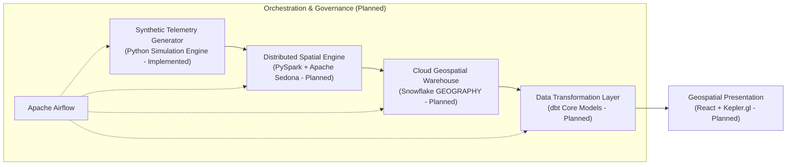

# GeoPulse: Hyper-Local Retail Mobility Analytics

[](#business-problem)
[](#current-project-status)
[](#data-privacy-and-synthetic-data-disclaimer)

GeoPulse is a modern geospatial analytics and data engineering platform engineered to analyze urban foot traffic, commercial corridor dynamics, and retail catchment overlap using privacy-preserving synthetic mobility telemetry.

---

## Business Problem

Brick-and-mortar retailers, commercial real estate developers, and urban commercial planners make high-stakes site selection, competitive positioning, and leasing decisions. Historically, these decisions relied on static demographic census estimates or isolated point-of-sale (POS) data, which exhibit severe limitations:

1. **Lack of Temporal Granularity**: Decennial census data fails to reflect dynamic weekday vs. weekend footfall or diurnal pedestrian volume curves.
2. **Invisible Competitor Footfall**: POS data only captures paying customers at existing locations, offering zero visibility into surrounding pedestrian traffic or competitor catchment absorption.
3. **Privacy and Compliance Barriers**: Commercial mobile mobility data (e.g., Mobile Advertising IDs / MAIDs) carries high financial costs, restrictive licensing terms, and severe regulatory risks under GDPR, CCPA/CPRA, and emerging privacy frameworks.
4. **Cannibalization Blindspots**: Retail chains expanding within dense metropolitan areas struggle to identify geographic trade area overlap between existing and prospective store locations.

## Proposed Solution

GeoPulse solves these challenges by combining a **synthetic mobile trajectory generator** with an enterprise-grade geospatial analytics pipeline. In its current implementation, the platform synthesizes plausible human movement around commercial clusters using a Python standard-library trajectory simulator featuring diurnal activity curve adherence, velocity-bounded kinematics, dwell anchoring, and predictive boundary steering.

Planned architectural phases will extend this foundation with distributed spatial indexing (Apache Sedona / PySpark), cloud geospatial warehousing (Snowflake), dimensional metric modeling (dbt), and exploratory visual analytics (Kepler.gl / React).

By leveraging synthetic observations generated under realistic urban mobility constraints, GeoPulse demonstrates production-grade spatial data engineering while eliminating personal data liabilities and commercial licensing overhead.

---

## Project Objectives

- **Synthetic Mobility Simulation (Implemented — Week 1)**: Generate realistic, high-frequency pedestrian and vehicular telemetry with configurable diurnal density curves, dwell times, and spatial noise using deterministic Python simulation.
- **Distributed Spatial Processing (Planned — Week 2)**: Employ PySpark and Apache Sedona to perform spatial filtering, trajectory indexing, and point-in-polygon containment joins against retail store polygons.
- **Cloud Geospatial Storage (Planned — Week 3)**: Implement an analytical data warehouse schema on Snowflake using native `GEOGRAPHY` data types, clustering keys, and spatial query patterns.
- **Dimensional & Spatial Modeling (Planned — Week 4)**: Build modular, tested data models with dbt to calculate footfall volume, median dwell times, catchment boundary polygons, and store cannibalization indices.
- **Interactive Geospatial Visualization (Planned — Week 5)**: Deliver an exploratory React and Kepler.gl web interface visualizing mobility heatmaps, trajectory playback, and catchment overlap zones.
- **Orchestrated Production Pipeline (Planned — Week 6)**: Construct reproducible Apache Airflow DAGs to orchestrate end-to-end data ingestion, spatial processing, warehouse loading, and transformation runs.

---

## Technology Stack and Responsibilities

| Technology | Implementation Status | Role & Responsibilities | Architectural Justification |
| :--- | :--- | :--- | :--- |
| **Python 3.10+ (Standard Library)** | **Implemented (Week 1)** | Core telemetry generation, geodetic utilities, kinematics simulation, unit testing | Zero external dependencies for core generation; standard-library determinism (`math`, `random`, `datetime`, `uuid`, `csv`). |
| **PySpark & Apache Sedona** | *Planned (Week 2)* | Distributed spatial processing, trajectory indexing, polygon containment | High-throughput distributed spatial joins (KDB-Tree / R-Tree partitioning) that scale to tens of millions of spatial records. |
| **Snowflake** | *Planned (Week 3)* | Cloud data warehousing, geospatial feature storage | Native `GEOGRAPHY` and `GEOMETRY` support, micro-partition spatial pruning, zero-copy cloning, and decoupled compute scaling. |
| **dbt (data build tool)** | *Planned (Week 4)* | SQL transformation, semantic modeling, data quality testing | Modular transformation lineage (Medallion architecture), automated documentation, and declarative testing for spatial integrity. |
| **Kepler.gl & React** | *Planned (Week 5)* | Hyper-local geospatial visualization, interactive analytical UI | GPU-accelerated WebGL rendering (via Deck.gl) capable of visualizing large-scale spatial trajectories and catchment polygons. |
| **Apache Airflow** | *Planned (Week 6)* | Workflow orchestration, pipeline scheduling, dependency management | Programmatic workflow definitions, retry mechanisms, execution tracking, and automated pipeline SLAs. |

---

## High-Level Pipeline (Planned Target Architecture)

The GeoPulse target data lifecycle follows an end-to-end workflow orchestrated by Apache Airflow:



### Processing Stages:

1. **Simulation & Ingestion (Implemented)**: Generates synthetic GPS breadcrumbs (`ping_id`, `device_id`, `event_timestamp`, `latitude`, `longitude`, `accuracy_meters`, `movement_mode`, `data_provenance`) adhering strictly to Day 1 schema contracts.
2. **Spatial Indexing & Boundary Join (Planned — Week 2)**: PySpark and Apache Sedona discretize points into discrete spatial cells (H3 / Geohash) and execute distributed spatial joins against retail Point of Interest (POI) footprints.
3. **Warehouse Staging (Planned — Week 3)**: Enriched observation datasets are staged and loaded into Snowflake raw tables utilizing native spatial types (`GEOGRAPHY`).
4. **Transformations & Catchment Modeling (Planned — Week 4)**: dbt models transform raw observations into dimensional models: identifying stay-points, calculating store visitation metrics, generating polygon isochrones/catchments, and quantifying brand cannibalization.
5. **Exploratory Visual Analytics (Planned — Week 5)**: Processed analytical marts are served to a React and Kepler.gl frontend for interactive spatial filtering, time-slider trajectory replay, and catchment overlap diagnosis.

---

## Repository Structure

```text
GeoPulse/
├── .editorconfig                # Universal code formatting and indentation rules
├── .gitattributes               # Line-ending normalization (LF) and binary classifications
├── .gitignore                   # Multi-tier data engineering and Python ignore rules
├── README.md                    # Primary repository documentation & project hub
├── data/
│   ├── processed/               # Intermediate & processed spatial Parquet artifacts (local, ignored)
│   │   └── .gitkeep
│   ├── raw/                     # Raw synthetic mobility CSV observations (local, ignored)
│   │   └── .gitkeep
│   └── reference/               # Retail POI definitions, municipal boundaries, and metadata
│       └── .gitkeep
├── docs/
│   ├── DATA_DICTIONARY.md       # Approved Day 1 spatial bounds, schema contract, and movement rules
│   ├── PROJECT_CHARTER.md       # Strategic charter, scope, governance, and development roadmap
│   └── TECHNICAL_OVERVIEW.md    # Technical design, component architectures, and planned pipeline
├── reports/
│   ├── .gitkeep
│   └── WEEK1_DAY2_GENERATION_REPORT.md  # Day 2 synthetic generation audit & kinematic verification
├── sql/
│   └── .gitkeep                 # Standalone SQL scripts, DDL definitions, and warehouse queries (Week 3)
├── src/
│   ├── .gitkeep
│   ├── __init__.py              # Python package marker
│   ├── config.py                # Day 1 bounding box, geodetic constants, and schema definitions
│   └── data_generator.py        # Day 2 synthetic heuristic trajectory generator engine
└── tests/
    ├── .gitkeep
    ├── __init__.py              # Python test package marker
    ├── test_data_generator.py   # Day 2 generator, kinematic, window, and reproducibility tests
    └── test_study_area_spec.py  # Day 1 spatial boundary and schema contract assertions
```

> **Note on Data Directories**: `data/raw/` and `data/processed/` contain `.gitkeep` files to maintain structure. Generated data files (`data/raw/*.csv`, `data/processed/*.parquet`) are strictly excluded from version control via `.gitignore`. Curated, non-sensitive reference files in `data/reference/` may be tracked as needed.

---

## Data Privacy and Synthetic Data Disclaimer

> [!IMPORTANT]
> **Zero Personally Identifiable Information (PII) Guarantee**
>
> All mobility observations, device identifiers, coordinate sequences, and dwell events utilized within the GeoPulse platform are **100% synthetically simulated**.
> - No real-world consumer telecommunication records, GPS tracking feeds, or Mobile Advertising IDs (MAIDs) are collected, processed, or persisted.
> - Simulated trajectories are synthesized algorithmically using geometric bounding envelopes, heuristic speed clamping, and dwell anchoring.
> - **Privacy-Conscious Engineering Disclaimer**: While this synthetic approach completely eliminates the collection and handling of personal data by design, it represents an engineering architectural choice and does not constitute an automatic legal compliance guarantee or formal statutory certification under privacy regulations (such as GDPR, CCPA/CPRA, or HIPAA).

---

## Reproducibility Principles

To guarantee deterministic builds and reproducible analytical outputs across environments:

- **Deterministic Seeds**: All synthetic generation runs incorporate an explicit pseudorandom seed (default `seed=42`) ensuring bitwise-reproducible CSV datasets under identical software environments.
- **Explicit Schema Enforcement**: Data boundaries between components are governed by strict schema contracts defined in `docs/DATA_DICTIONARY.md` and enforced in `src/config.py`.
- **Environment Parity**: Tooling configurations (`.editorconfig`, `.gitattributes`, dependency locks) eliminate OS-specific divergences.
- **Idempotent Data Pipelines**: Planned transformation models in dbt and staging tasks in Airflow will be authored to ensure idempotency upon re-execution.

---

## Project Limitations

- **Synthetic Trajectory Heuristics**: The current generator models agent motion via velocity-bounded random walks with dwell anchoring and predictive boundary steering; it does not currently simulate physical road network turn restrictions or multi-agent traffic congestion (planned for subsequent GIS refinement).
- **Predictive Boundary Steering**: Predictive inward steering is an algorithmic simulation rule to keep simulated agents within the study bounding box; it is not physical road-network navigation or vehicular steering physics.
- **No Measured Footfall Claims**: All visitor volumes, dwell times, and catchment geometries are synthetic simulation outputs designed for engineering pipeline validation, not observed real-world retail consumer traffic.
- **Simplified POI Footprints**: Planned retail building polygons and commercial zones are derived from open geometric envelopes rather than proprietary licensed cadastral datasets.

---

## Current Project Status

- **Overall Status**: **Week 1 Day 2 Complete**
- **Milestone Progress**:
  - [x] Repository Foundation: Complete (Git setup, governance, `.editorconfig`, `.gitignore`, `.gitattributes`, [docs/PROJECT_CHARTER.md](docs/PROJECT_CHARTER.md), [docs/TECHNICAL_OVERVIEW.md](docs/TECHNICAL_OVERVIEW.md))
  - [x] Week 1 Day 1: Complete — Mobility Data Specification & Environment Foundation ([docs/DATA_DICTIONARY.md](docs/DATA_DICTIONARY.md), `src/config.py`, `tests/test_study_area_spec.py`)
  - [x] Week 1 Day 2: Complete — Synthetic Telemetry Generator Engine ([reports/WEEK1_DAY2_GENERATION_REPORT.md](reports/WEEK1_DAY2_GENERATION_REPORT.md), `src/data_generator.py`, `tests/test_data_generator.py`)
  - [ ] Week 1 Day 3: Pending — Data Quality and Mobility Validation (Primary: missing values, duplicates, coordinate bounds, timestamp consistency, device chronology, speed limits, interval compliance, and trajectory validation; Supporting: exploratory spatial distribution summaries)
  - [ ] Week 2: Planned — Apache Sedona Distributed Spatial Processing & Indexing
  - [ ] Week 3: Planned — Snowflake Geospatial Warehousing & Ingestion
  - [ ] Week 4: Planned — dbt Dimensional Transformations & Catchment Overlap Modeling
  - [ ] Week 5: Planned — Interactive Kepler.gl / React Visualization Dashboard
  - [ ] Week 6: Planned — End-to-End Apache Airflow Orchestration & Quality Verification

---

## License

The license for this project has not yet been selected. All rights are reserved until an open-source or permissive software license is formally designated.
