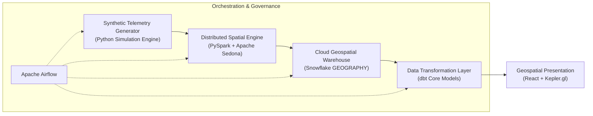

# GeoPulse: Hyper-Local Retail Mobility Analytics

[](#domain)
[](#current-project-status)
[](LICENSE)
[](#data-privacy-and-synthetic-data-disclaimer)

GeoPulse is a modern geospatial analytics and data engineering platform engineered to analyze urban foot traffic, commercial corridor dynamics, and retail catchment overlap using privacy-preserving synthetic mobility telemetry.

---

## Business Problem

Brick-and-mortar retailers, commercial real estate developers, and urban commercial planners make high-stakes site selection, competitive positioning, and leasing decisions. Historically, these decisions relied on static demographic census estimates or isolated point-of-sale (POS) data, which exhibit severe limitations:

1. **Lack of Temporal Granularity**: Decennial census data fails to reflect dynamic weekday vs. weekend footfall or diurnal pedestrian volume curves.
2. **Invisible Competitor Footfall**: POS data only captures paying customers at existing locations, offering zero visibility into surrounding pedestrian traffic or competitor catchment absorption.
3. **Privacy and Compliance Barriers**: Commercial mobile mobility data (e.g., Mobile Advertising IDs / MAIDs) carries high financial costs, restrictive licensing terms, and severe regulatory risks under GDPR, CCPA/CPRA, and emerging privacy frameworks.
4. **Cannibalization Blindspots**: Retail chains expanding within dense metropolitan areas struggle to identify geographic trade area overlap between existing and prospective store locations.

## Proposed Solution

GeoPulse solves these challenges by combining a **synthetic mobile trajectory generator** with an enterprise-grade geospatial analytics pipeline. The platform models plausible human movement around commercial clusters, applies distributed spatial indexing and boundary joins, stores spatial features in a cloud data warehouse, models analytical metrics using modern transformation tools, and surfaces actionable spatial intelligence via an interactive visualization interface.

By leveraging synthetic observations generated under realistic urban mobility constraints (gravity models, diurnal cycles, and street network routing), GeoPulse demonstrates production-grade spatial engineering while eliminating privacy risks and data licensing overhead.

---

## Project Objectives

- **Synthetic Mobility Simulation**: Generate realistic, high-frequency pedestrian and vehicular telemetry with configurable diurnal density curves, dwell times, and spatial noise.
- **Distributed Spatial Processing**: Employ PySpark and Apache Sedona to perform spatial filtering, trajectory map matching, and point-in-polygon containment joins against retail polygons.
- **Cloud Geospatial Storage**: Implement an analytical data warehouse schema on Snowflake using native `GEOGRAPHY` data types, clustering keys, and spatial query patterns.
- **Dimensional & Spatial Modeling**: Build modular, tested data models with dbt to calculate footfall volume, median dwell times, catchment boundary polygons, and store cannibalization indices.
- **Interactive Geospatial Visualization**: Deliver an exploratory React and Kepler.gl web interface visualizing mobility heatmaps, trajectory playback, and catchment overlap zones.
- **Orchestrated Production Pipeline**: Construct reproducible Apache Airflow DAGs to orchestrate end-to-end data ingestion, spatial processing, warehouse loading, and transformation runs.

---

## Technology Stack and Responsibilities

| Technology | Role & Responsibilities | Architectural Justification |
| :--- | :--- | :--- |
| **Python 3.10+** | Core telemetry generation, geometric utilities, simulation logic | Rich geospatial ecosystem (`Shapely`, `GeoPandas`, `H3-Py`) and native integration across data platforms. |
| **PySpark & Apache Sedona** | Distributed spatial processing, trajectory indexing, polygon containment | High-throughput distributed spatial joins (KDB-Tree / R-Tree partitioning) that scale to tens of millions of spatial records. |
| **Snowflake** | Cloud data warehousing, geospatial feature storage | Native `GEOGRAPHY` and `GEOMETRY` support, micro-partition spatial pruning, zero-copy cloning, and decoupled compute scaling. |
| **dbt (data build tool)** | SQL transformation, semantic modeling, data quality testing | Modular transformation lineage (Medallion architecture), automated documentation, and declarative testing for spatial integrity. |
| **Kepler.gl & React** | Hyper-local geospatial visualization, interactive analytical UI | GPU-accelerated WebGL rendering (via Deck.gl) capable of visualizing large-scale spatial trajectories and catchment polygons. |
| **Apache Airflow** | Workflow orchestration, pipeline scheduling, dependency management | Programmatic workflow definitions, retry mechanisms, execution tracking, and automated pipeline SLAs. |

---

## High-Level Pipeline

The GeoPulse data lifecycle follows an end-to-end workflow orchestrated by Apache Airflow:



### Processing Stages:

1. **Simulation & Ingestion**: Generates synthetic GPS breadcrumbs (`device_id`, `timestamp`, `latitude`, `longitude`, `speed`, `accuracy`) along metropolitan road and pedestrian networks.
2. **Spatial Indexing & Boundary Join**: PySpark and Apache Sedona discretize points into discrete spatial cells (H3 / Geohash) and execute distributed spatial joins against retail Point of Interest (POI) footprints.
3. **Warehouse Staging**: Enriched observation datasets are staged and loaded into Snowflake raw tables utilizing native spatial types.
4. **Transformations & Catchment Modeling**: dbt models transform raw observations into dimensional models: identifying stay-points, calculating store visitation metrics, generating polygon isochrones/catchments, and quantifying brand cannibalization.
5. **Exploratory Visual Analytics**: Processed analytical marts are served to a React and Kepler.gl frontend for interactive spatial filtering, time-slider trajectory replay, and catchment overlap diagnosis.

---

## Repository Structure

```text
GeoPulse/
├── docs/
│   ├── PROJECT_CHARTER.md       # Strategic charter, scope, governance, and development roadmap
│   └── TECHNICAL_OVERVIEW.md    # Technical design, component architectures, and data models
├── data/
│   ├── raw/                     # Directory for uncommitted raw synthetic mobility observations
│   ├── processed/               # Intermediate & processed spatial Parquet artifacts
│   └── reference/               # Retail POI definitions, municipal boundaries, and metadata
├── src/                         # Core Python source code (generator, Spark jobs, utilities)
├── sql/                         # Standalone SQL scripts, DDL definitions, and warehouse queries
├── tests/                       # Unit, integration, and spatial property test suites
├── reports/                     # Analytical findings, architecture diagrams, and benchmark outputs
├── .editorconfig                # Universal code formatting and indentation rules
├── .gitignore                   # Multi-tier data engineering and Python ignore rules
└── README.md                    # Primary repository documentation
```

> **Note on Data Directories**: `data/raw/` and `data/processed/` contain `.gitkeep` files to maintain structure. Generated data files are strictly excluded from version control via `.gitignore`. Curated, non-sensitive reference files (e.g., small GeoJSON boundaries) in `data/reference/` may be tracked as needed.

---

## Data Privacy and Synthetic Data Disclaimer

> [!IMPORTANT]
> **Zero Personally Identifiable Information (PII) Guarantee**
>
> All mobility observations, device identifiers, coordinate sequences, and dwell events utilized within the GeoPulse platform are **100% synthetically simulated**.
> - No real-world consumer telecommunication records, GPS tracking feeds, or Mobile Advertising IDs (MAIDs) are collected, processed, or persisted.
> - Simulated trajectories are synthesized mathematically using urban centroids, open road network topologies, and stochastic distribution functions.
> - The methodology is inherently compliant with privacy regulations including GDPR, CCPA/CPRA, and HIPAA by design.

---

## Reproducibility Principles

To guarantee deterministic builds and reproducible analytical outputs across environments:

- **Deterministic Seeds**: All synthetic generation pipelines incorporate explicit pseudorandom seeds to ensure reproducible spatial trajectories.
- **Explicit Schema Enforcement**: Data boundaries between components are governed by strict schema contracts defined in Apache Parquet, Snowflake DDL, and dbt schema specifications.
- **Environment Parity**: Tooling configurations (`.editorconfig`, dependency locks, and environment templates) eliminate OS-specific divergences.
- **Idempotent Data Pipelines**: Transformation models in dbt and staging tasks in Airflow are authored to ensure idempotency upon re-execution.

---

## Project Limitations

- **Synthetic Behavioral Approximations**: Synthetic mobility traces rely on algorithmic movement models (e.g., random walks, shortest-path routing, gravity models) and may not capture edge-case human behavioral idiosyncrasies.
- **Compute Constraints**: Distributed spatial processing benchmarks reflect development and single-cluster operational scale rather than telecom-grade petabyte stream processing.
- **Mock POI Footprints**: Retail building polygons and commercial zones are derived from public OpenStreetMap (OSM) vectors or synthetic envelopes rather than commercial proprietary POI licensing datasets.

---

## Current Project Status

- **Phase**: **Repository Foundation & Architectural Initialization**
- **Active Deliverables**:
  - [x] Repository topology and configuration (.gitignore, .editorconfig)
  - [x] Project Charter and Strategic Scope ([docs/PROJECT_CHARTER.md](docs/PROJECT_CHARTER.md))
  - [x] Technical Architecture Overview ([docs/TECHNICAL_OVERVIEW.md](docs/TECHNICAL_OVERVIEW.md))
  - [ ] Week 1 Day 1: Telemetry Generation Engine & Schema Contract (Pending Approval)
  - [ ] Week 2: Apache Sedona Spatial Processing & Indexing
  - [ ] Week 3: Snowflake Geospatial Warehousing & Ingestion
  - [ ] Week 4: dbt Dimensional Transformations & Catchment Overlap Modeling
  - [ ] Week 5: Interactive Kepler.gl Visualization Dashboard
  - [ ] Week 6: End-to-end Airflow Orchestration & Quality Verification
