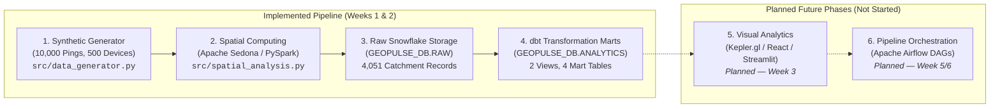

# GeoPulse: Hyper-Local Retail Mobility Analytics

[](#business-problem)
[](#current-project-status)
[](#testing-and-validation-results)
[](#data-privacy-and-synthetic-data-disclaimer)

GeoPulse is a geospatial analytics and data engineering platform engineered to model urban foot traffic, commercial corridor dynamics, and retail catchment overlap using privacy-preserving synthetic mobility telemetry.

---

## Business Problem

Brick-and-mortar retailers, commercial real estate developers, and urban planners make high-stakes site selection, competitive positioning, and leasing decisions. Historically, these decisions relied on static demographic census estimates or isolated point-of-sale (POS) data, which exhibit severe limitations:

1. **Lack of Temporal Granularity**: Decennial census data fails to reflect dynamic weekday vs. weekend footfall or diurnal pedestrian volume curves.
2. **Invisible Competitor Footfall**: POS data only captures paying customers at existing locations, offering zero visibility into surrounding pedestrian traffic or competitor catchment absorption.
3. **Privacy and Compliance Barriers**: Commercial mobile mobility data (e.g., Mobile Advertising IDs / MAIDs) carries high financial costs, restrictive licensing terms, and severe regulatory risks under privacy frameworks.
4. **Cannibalization Blindspots**: Retail chains expanding within dense metropolitan areas struggle to identify geographic trade area overlap between existing and prospective store locations.

## Implemented Solution (Weeks 1 & 2)

GeoPulse solves these challenges by combining a **deterministic synthetic mobility trajectory generator** with a staged geospatial data engineering and cloud warehousing pipeline:

- **Week 1 (Synthetic Telemetry & Snowflake Foundation)**: Synthesizes plausible urban movement around commercial clusters in Indiranagar, Bengaluru, using a Python standard-library simulation engine (10,000 observations, 500 devices, seed `42`). Provisions Snowflake storage (`GEOPULSE_DB`) and ingests raw observations into native `GEOGRAPHY` points.
- **Week 2 (Spatial Catchments & Snowflake dbt ELT)**: Projects coordinates into UTM Zone 43N (`EPSG:32643`) using Apache Sedona and PySpark, constructs 500-metre planar catchment buffers around 4 candidate retail stores, and executes spatial point-in-polygon joins matching 4,051 membership records. Materializes 6 dbt models in Snowflake across 4 dimensional marts, achieving **100% exact cross-platform metric parity** with the PySpark baseline.

---

## Implemented Architecture & Data Flow



### Analytical Transformation Stages:
1. **Simulation & Ingestion (`src/data_generator.py`, `src/data_quality.py`)**: Generates and validates canonical CSV records (`ping_id`, `device_id`, `event_timestamp`, `latitude`, `longitude`, `accuracy_meters`, `movement_mode`, `data_provenance`) adhering strictly to data contracts.
2. **Distributed Spatial Join (`src/spatial_analysis.py`)**: Re-projects geodetic coordinates (WGS 84 / `EPSG:4326`) into a planar metric system (UTM Zone 43N / `EPSG:32643`), generates 500-metre planar catchment buffers (regular 32-gons; area ~780,361 m²), and executes spatial point-in-polygon joins matching 4,051 membership records.
3. **Retail Mobility Analytics (`src/retail_mobility_analytics.py`)**: Converts UTC timestamps to Indian Standard Time (`Asia/Kolkata`, UTC+05:30), assigns 4 diurnal dayparts, and outputs baseline PySpark CSV datasets.
4. **Snowflake dbt Dimensional Modeling (`dbt/geopulse_analytics/`)**: Materializes 2 views and 4 tables in `GEOPULSE_DB.ANALYTICS`:
   - `stg_store_catchment_memberships` (View): Standardizes columns, converts UTC to IST, extracts dates/hours, and assigns diurnal periods.
   - `int_store_memberships_overlap_tagged` (View): Tags ping- and device-level multi-catchment overlaps via independent CTEs with 0 Cartesian fan-out.
   - `fct_hourly_store_activity` (Table, 81 rows): Hourly aggregated pings and distinct devices per store and date.
   - `fct_store_time_of_day_activity` (Table, 16 rows): Daypart aggregated footfall across 4 diurnal windows.
   - `fct_daily_store_summary` (Table, 8 rows): Daily summary metrics per store, active hours, and visit intensity (`pings_per_device`).
   - `fct_store_overlap_summary` (Table, 4 rows): Per-store catchment exclusivity and multi-catchment device distributions.

---

## Technology Stack and Responsibilities

| Technology | Implementation Status | Role & Responsibilities |
| :--- | :---: | :--- |
| **Python 3.12 (Standard Library)** | **Implemented (Weeks 1 & 2)** | Core trajectory generation, kinematics, data-quality validation, and regression test suites. |
| **PySpark 3.5 & Apache Sedona 1.9** | **Implemented (Week 2)** | Planar coordinate projection (UTM 43N), 500m buffer generation, spatial containment joins, and baseline retail analytics. |
| **Snowflake Data Cloud** | **Implemented (Weeks 1 & 2)** | Cloud analytical store, native `GEOGRAPHY` point modeling, raw landing tables (`GEOPULSE_DB.RAW`), and analytics schema (`GEOPULSE_DB.ANALYTICS`). |
| **dbt Core 1.12.7 & dbt-snowflake 1.12.5** | **Implemented (Week 2)** | Modular dimensional modeling (2 views, 4 tables), schema testing, and cross-platform metric parity validation. |
| **Kepler.gl, React & Streamlit** | *Planned (Week 3 — Not Started)* | Interactive visual analytics, 3D spatial trajectory playback, and alpha-blended catchment overlap corridors. |
| **OpenStreetMap & NetworkX** | *Planned (Week 4 — Not Started)* | Street-network graph routing and pedestrian walking-reach travel-time isochrones. |
| **Apache Airflow** | *Planned (Week 5/6 — Not Started)* | Production workflow orchestration, dependency scheduling, and automated SLA monitoring. |

---

## Testing and Validation Results

The repository incorporates automated test suites across Python and dbt layers, totaling **241 automated tests passing** (176 Python + 65 dbt). In addition, a standalone Java shim integration test verifies 7 filesystem operations:

```text
============================= Python Test Suite =============================
tests/test_study_area_spec.py ....................                     (9 passed)
tests/test_data_generator.py ....................                     (20 passed)
tests/test_data_quality.py ....................................       (36 passed)
tests/test_spatial_analysis.py ...................................... (58 passed)
tests/test_retail_mobility_analytics.py ............................. (53 passed)
Total Python Tests: 176 passed in 1.41s (0 failures, 0 errors)

============================== dbt Test Suite ===============================
Source Tests (raw_store_catchment_memberships) ....................... (10 passed)
Model Schema Tests (uniqueness, not-null, relationships, accepted) ... (49 passed)
Singular Integration Tests (row counts, grain uniqueness, invariants) . (6 passed)
Total dbt Tests: 65 passed in 73.84s (0 failures, 0 errors, 0 warnings)

================== Standalone Java Shim Integration Harness =================
TestWindowsLocalFileSystem (Adoptium OpenJDK 11) ........... (7/7 steps passed)
(Note: 7 integration steps are verified separately and not included in the 241 count)
```

### Spark-to-Snowflake Metric Parity
Every metric across the four analytical marts was verified row-by-row and column-by-column between Snowflake tables and PySpark baseline CSVs:

| Mart Model | Snowflake Grain / Rows | Spark Grain / Rows | Column Parity | Discrepancies (Max Abs Diff) | Total Pings Reconciled |
| :--- | :---: | :---: | :---: | :---: | :---: |
| `fct_hourly_store_activity` | `(store, date, hour)` / **81** | `(store, date, hour)` / **81** | Identical (6 cols) | **0 mismatches** (`diff = 0.0`) | **4,051** SF / **4,051** Spark |
| `fct_store_time_of_day_activity` | `(store, daypart)` / **16** | `(store, daypart)` / **16** | Identical (5 cols) | **0 mismatches** (`diff = 0.0`) | **4,051** SF / **4,051** Spark |
| `fct_daily_store_summary` | `(store, date)` / **8** | `(store, date)` / **8** | Identical (7 cols) | **0 mismatches** (`diff = 0.0`) | **4,051** SF / **4,051** Spark |
| `fct_store_overlap_summary` | `(store)` / **4** | `(store)` / **4** | Identical (8 cols) | **0 mismatches** (`diff = 0.0`) | **4,051** SF / **4,051** Spark |

### 100K Local Spark Spatial Benchmark (Run 1)
To evaluate the local execution performance and memory footprint of the Apache Sedona spatial containment engine on a single developer workstation, a **100,000-record local Spark spatial benchmark** was executed on 2026-11-25 under strict telemetry monitoring:

- **Volume & Entities**: 100,000 synthetic mobility records across 5,000 simulated devices (seed `42`).
- **Engine Execution**: Apache Sedona 1.9.1 on PySpark 3.5.9, Java 11.0.33, `local[2]` (single-node local execution), 1536 MB driver heap, 4 shuffle partitions, UTC timezone, Arrow disabled.
- **Execution Performance**: Total wall-clock time **24.002 seconds**; pipeline execution time **12.701 seconds**.
- **Spatial Containment Output**: Matched **43,283 catchment memberships** across 4 candidate stores:
  - **STORE_A (GeoPulse Coffee A)**: 11,307 matched pings, 1,394 distinct devices
  - **STORE_B (GeoPulse Coffee B)**: 12,436 matched pings, 1,593 distinct devices
  - **STORE_C (GeoPulse Coffee C)**: 10,607 matched pings, 1,378 distinct devices
  - **STORE_D (GeoPulse Coffee D)**: 8,933 matched pings, 1,135 distinct devices
- **Mathematical Invariant & Overlap**: $40,927\text{ (single-catchment)} + 2 \times 1,178\text{ (two-catchment)} = 43,283\text{ memberships}$ ($42,105$ overall distinct matched pings, $3,631$ overall distinct matched devices).
- **Pure-Java Windows Hadoop Shim**: Bypassed Windows native C++ dependencies (`winutils.exe` and `NativeIO$Windows.access0`) via custom in-repo Java class `com.geopulse.hadoop.WindowsLocalFileSystem` without external binary downloads.
- **Formal Technical Review**: Detailed audit findings, memory dynamics (4 GiB pre-launch gate vs. 3.58 GiB runtime minimum), and single-node local execution scope are documented in [reports/MID_PROJECT_TECHNICAL_REVIEW.md](reports/MID_PROJECT_TECHNICAL_REVIEW.md).

---

## Repository Structure

```text
GeoPulse/
├── .editorconfig                # Universal code formatting rules
├── .gitattributes               # Line-ending normalization (LF)
├── .gitignore                   # Multi-tier ignore rules (protects data, target, logs, profiles)
├── README.md                    # Primary repository documentation & project hub
├── data/
│   ├── processed/               # Processed spatial CSV outputs (local, gitignored)
│   ├── raw/                     # Raw synthetic mobility CSV observations (local, gitignored)
│   └── reference/               # Retail candidate locations (synthetic_store_locations.csv)
├── dbt/
│   └── geopulse_analytics/      # Complete dbt ELT project
│       ├── dbt_project.yml      # dbt project configuration and model materializations
│       ├── README.md            # dbt project documentation and execution instructions
│       ├── models/
│       │   ├── staging/         # _sources.yml, stg_store_catchment_memberships (.sql / .yml)
│       │   ├── intermediate/    # int_store_memberships_overlap_tagged (.sql / .yml)
│       │   └── marts/           # 4 analytical mart SQL models and marts.yml
│       └── tests/               # 6 singular SQL integration and reconciliation tests
├── docs/
│   ├── DATA_DICTIONARY.md       # Approved spatial bounds, schema contracts, and kinematic rules
│   ├── PROJECT_CHARTER.md       # Project charter, milestone governance, and scope boundaries
│   └── TECHNICAL_OVERVIEW.md    # Technical architecture, component deep-dives, and data models
├── reports/
│   ├── MID_PROJECT_TECHNICAL_REVIEW.md # Mid-project technical review & 100K local benchmark audit
│   ├── WEEK1_COMPLETION_REPORT.md   # Consolidated Week 1 foundation & engineering closeout report
│   └── WEEK2_COMPLETION_REPORT.md   # Consolidated Week 2 spatial analytics & dbt ELT closeout report
├── scripts/
│   └── benchmark_100k.py        # 100K local Spark spatial benchmark runner
├── sql/
│   └── snowflake/               # Prepared Snowflake DDL & spatial transformation scripts
│       ├── 001_create_raw_mobility_table.sql
│       └── 002_create_spatial_mobility_table.sql
├── src/
│   ├── config.py                # Bounding box coordinates, geodetic constants, schema contracts
│   ├── data_generator.py        # Deterministic synthetic mobility trajectory generator engine
│   ├── data_quality.py          # Data quality validation engine and contract verification
│   ├── spatial_analysis.py      # Apache Sedona planar projection and 500m buffer join pipeline
│   └── retail_mobility_analytics.py # PySpark retail mobility analytics and baseline generation
├── tests/
│   ├── test_study_area_spec.py  # Spatial boundary and schema contract unit tests
│   ├── test_data_generator.py   # Generator kinematics and reproducibility tests
│   ├── test_data_quality.py     # Schema, boundary, and velocity assertion test suites
│   ├── test_spatial_analysis.py # Spatial projection, buffer geometry, and membership join tests
│   └── test_retail_mobility_analytics.py # Retail aggregation, diurnal windows, and reconciliation tests
└── tools/
    └── shims/                   # Pure-Java Windows Hadoop filesystem shim
        ├── WindowsLocalFileSystem.java     # Source shim overriding RawLocalFileSystem
        ├── TestWindowsLocalFileSystem.java # Standalone 7-stage verification test
        └── windows-hadoop-shim.jar        # Locally generated, Git-ignored build artifact
```

---

## Data Privacy and Synthetic Data Disclaimer

> [!IMPORTANT]
> **Zero Personally Identifiable Information (PII) Guarantee**
>
> All mobility observations, device identifiers, coordinate sequences, and dwell events utilized within the GeoPulse platform are **100% synthetically simulated**.
> - No real-world consumer telecommunication records, GPS tracking feeds, or Mobile Advertising IDs (MAIDs) are collected, processed, or persisted.
> - Simulated trajectories are synthesized algorithmically using geometric bounding envelopes, heuristic speed clamping, and dwell anchoring.
> - **Engineering Choice Disclaimer**: While this synthetic approach completely eliminates personal data collection by design, it represents an engineering architectural choice and does not constitute an automatic statutory certification under privacy regulations.

---

## Project Limitations and Analytical Disclaimers

To maintain academic and professional standards, the following technical constraints apply:

1. **Synthetic Nature of Mobility Data**: The 10,000 observations and 500 devices were generated using GeoPulse's kinematic generator (`geopulse_synthetic_v1`, seed `42`). Observations represent simulated trajectories along synthetic corridors; they do not reflect actual human foot-traffic, GPS telemetry from smartphones, or telecom CDR records.
2. **Hypothetical Retail Candidates**: Stores A, B, C, and D are synthetic coordinate pairs within Indiranagar, Bengaluru. They do not correspond to registered commercial entities, real coffee shops, or verified street addresses.
3. **Spatial Proximity vs. Commercial Footfall**: Catchment membership signifies geometric presence within a 500-metre radius of a candidate store point. A membership record indicates spatial proximity only; it does **not** indicate an actual commercial store visit, physical indoor entry, lingering dwell, or retail transaction.
4. **Catchment Overlap vs. Store Cannibalization**: The 95 multi-catchment pings represent overlapping spatial buffers, not customer brand switching, shared customer loyalty, or commercial cannibalization.
5. **Planar Projection Geometry**: Catchments are circular buffers in UTM Zone 43N (`EPSG:32643`). Buffers are planar representations that do not account for physical topography, building footprints, pedestrian barriers, or street network walking times (isochrones).

---

## Current Project Status

- **Overall Status**: **Week 1 & Week 2 Complete — Week 3 Not Started**
- **Milestone Progress**:
  - [x] **Repository Foundation**: Git configuration, governance, `.editorconfig`, `.gitignore`, `.gitattributes`, [docs/PROJECT_CHARTER.md](docs/PROJECT_CHARTER.md), [docs/TECHNICAL_OVERVIEW.md](docs/TECHNICAL_OVERVIEW.md)
  - [x] **Week 1 (Synthetic Telemetry & Snowflake Foundation)**: [reports/WEEK1_COMPLETION_REPORT.md](reports/WEEK1_COMPLETION_REPORT.md)
    - [x] Mobility data specification and contract assertions (`src/config.py`, `docs/DATA_DICTIONARY.md`, `tests/test_study_area_spec.py`)
    - [x] Deterministic trajectory generator (`src/data_generator.py`, `tests/test_data_generator.py`, 10,000 pings, seed `42`)
    - [x] Independent data quality validation engine (`src/data_quality.py`, `tests/test_data_quality.py`, 36 tests)
    - [x] Snowflake DDL and spatial tables (`sql/snowflake/`, `RAW_MOBILITY_PINGS`, `STG_SPATIAL_MOBILITY_PINGS`)
  - [x] **Week 2 (Spatial Analytics & Snowflake dbt ELT)**: [reports/WEEK2_COMPLETION_REPORT.md](reports/WEEK2_COMPLETION_REPORT.md)
    - [x] Apache Sedona planar projection (UTM 43N) and 500m buffer join (`src/spatial_analysis.py`, 4,051 memberships)
    - [x] PySpark retail mobility analytics engine (`src/retail_mobility_analytics.py`, 4 baseline datasets)
    - [x] Snowflake dbt ELT project (`dbt/geopulse_analytics/`, 2 views, 4 mart tables)
    - [x] Automated test suite: 176 Python tests + 65 dbt tests = 241 automated tests passing
    - [x] 100% exact numerical metric reconciliation between PySpark baseline and Snowflake tables
  - [x] **Mid-Project Milestone & 100K Local Spark Spatial Benchmark**: [reports/MID_PROJECT_TECHNICAL_REVIEW.md](reports/MID_PROJECT_TECHNICAL_REVIEW.md)
    - [x] Windows Hadoop NativeIO resolution via pure-Java filesystem shim (`tools/shims/`)
    - [x] 100K local Spark spatial containment benchmark (Run 1: 24.002s wall-clock, 43,283 memberships)
    - [x] Real-time memory profiling via Win32 ctypes and psutil dual telemetry
    - [x] Comprehensive mid-project technical review and academic originality audit
  - [ ] **Week 3: Planned / Not Started** — Interactive Geospatial Visualization & Dashboard (Kepler.gl / React / Streamlit)
  - [ ] **Week 4: Planned / Not Started** — Advanced Dwell-Time Clustering & Walking-Network Isochrone Modeling
  - [ ] **Week 5/6: Planned / Not Started** — End-to-End Apache Airflow Orchestration & CI/CD Pipelines

---

## License

The license for this project has not yet been selected. All rights are reserved until an open-source or permissive software license is formally designated.
