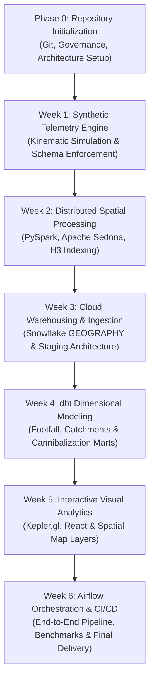

# GeoPulse: Project Charter

## 1. Project Information

| Field | Detail |
| :--- | :--- |
| **Project Name** | GeoPulse: Hyper-Local Retail Mobility Analytics |
| **Domain** | Retail Strategy, Geospatial Engineering, and Urban Mobility Analytics |
| **Repository** | `https://github.com/dileep-songa/geopulse-hyperlocal-retail-mobility-analytics` |
| **Author / Lead** | Dileep Songa (Internship Project) |
| **Project Stage** | Repository Foundation / Pre-Development Initialization |
| **Target Audience** | Data Engineering Evaluators, Geospatial Architects, Retail Analytics Leads |

---

## 2. Problem Statement

Retail store network planning and commercial corridor optimization require granular, timely insights into human mobility. Understanding how consumers move through physical spaces—which retail corridors they frequent, how long they linger, and where store catchment zones overlap—is vital for competitive survival.

Historically, organizations have relied on:
- **Static Decennial Census Data**: Reliable for broad demographics, but completely disconnected from intra-day, weekday/weekend, or seasonal foot traffic patterns.
- **Internal Point-of-Sale (POS) Logs**: Highly accurate for paying customers inside a specific store, but blind to prospective customers walking past the storefront or patronizing adjacent competitors.
- **Commercial Aggregated GPS Telemetry**: Prohibitively expensive (often hundreds of thousands of dollars annually), legally perilous under GDPR/CCPA, and fraught with vendor lock-in and shifting attribution methodologies.

Furthermore, multi-unit retail brands face significant risk of **store cannibalization**: opening a new location that pulls customers away from an existing branch rather than capturing net-new market share. Retailers lack open, reproducible data engineering frameworks capable of modeling spatial catchment overlap and cannibalization dynamics without immense commercial licensing fees.

---

## 3. Proposed Solution

**GeoPulse** is an end-to-end geospatial intelligence platform powered by mathematically modeled, synthetic mobile mobility observations. The platform simulates realistic urban pedestrian and vehicular trajectories, processes spatial interactions at scale, and loads the data into a modern cloud data warehouse for analytical modeling and spatial visualization.

By coupling synthetic data simulation with modern data engineering tooling:
1. **Privacy-by-Design**: Completely eliminates real-world consumer tracking and PII liabilities while preserving realistic spatial-temporal properties.
2. **Open Architectural Pattern**: Demonstrates a complete reference architecture connecting distributed spatial computing (Apache Sedona / PySpark), cloud data warehousing (Snowflake), transformation and data testing (dbt), and geospatial visualization (Kepler.gl / React).
3. **Actionable Retail Intelligence**: Computes store catchment zones, visit duration distributions, footfall volume heatmaps, and spatial cannibalization metrics for retail networks.

---

## 4. Objectives

### 4.1 Engineering Objectives
- **Scalable Ingestion & Transformation**: Process millions of synthetic mobility points using distributed spatial partitioning (KDB-Tree / R-Tree) in Apache Sedona.
- **Standardized Cloud Storage**: Structure a Snowflake warehouse leveraging native `GEOGRAPHY` objects, spatial functions (`ST_CONTAINS`, `ST_DWITHIN`), and micro-partition clustering.
- **Automated Data Quality & Lineage**: Implement dbt models with comprehensive test coverage (uniqueness, referential integrity, spatial validity assertions).
- **Production Orchestration**: Orchestrate data generation, Spark jobs, Snowflake staging, and dbt runs via declarative Apache Airflow DAGs.

### 4.2 Analytical Objectives
- **Catchment Identification**: Formulate dynamic retail trade catchments (isochrones and convex/concave hulls) based on simulated pedestrian travel distances.
- **Cannibalization Modeling**: Measure the geometric and volume-weighted intersection between overlapping trade areas of neighboring brand units.
- **Footfall & Dwell Dynamics**: Calculate hourly, daily, and diurnal foot traffic density curves and median dwell times across commercial zones.

---

## 5. Functional Scope

### 5.1 In-Scope
- **Synthetic Mobility Simulation**:
  - Configurable spatial bounding boxes (commercial urban districts).
  - Plausible kinematic models (pedestrian walking speeds, road network routing, dwell stop points).
  - Injection of realistic GPS measurement variance (Gaussian spatial jitter).
- **Spatial Data Engineering**:
  - Spatial indexing via H3 discrete global grid system or Geohash.
  - Point-in-polygon spatial containment joining simulated telemetry against retail building polygons.
- **Warehouse & Transformation Pipeline**:
  - Medallion architecture (Bronze -> Silver -> Gold) inside Snowflake.
  - dbt-managed dimensional modeling (facts, dimensions, spatial summary marts).
- **Interactive Visualization**:
  - Standalone React application integrating Kepler.gl for 3D spatial rendering, trajectory playback, and catchment overlap exploration.
- **Workflow Orchestration**:
  - Airflow DAG definitions for automated execution, backfill management, and pipeline health monitoring.

### 5.2 Out-of-Scope
- Ingestion of real-world consumer cellular telemetry, Call Detail Records (CDRs), or real Mobile Advertising IDs (MAIDs).
- Integration with live commercial point-of-sale (POS) transactional hardware or enterprise ERP backends.
- Real-time sub-second streaming inference (the project focuses on high-throughput micro-batch and scheduled analytical pipelines).
- Multi-million-dollar proprietary commercial street network licensing (open-source OpenStreetMap data is utilized).

---

## 6. Technology Stack

| Layer | Component | Version / Tool | Purpose in GeoPulse |
| :--- | :--- | :--- | :--- |
| **Language** | Python | 3.10+ | Core trajectory generator, geometric processing scripts, pipeline coordination |
| **Distributed Spatial** | PySpark & Sedona | Spark 3.4+ / Sedona 1.5+ | Distributed spatial indexing, trajectory segmentation, point-in-polygon joins |
| **Data Warehouse** | Snowflake | Standard Edition | Cloud analytical store, spatial SQL processing, micro-partition clustering |
| **Transformation** | dbt | dbt-core / dbt-snowflake | Modularity, testing, documentation, dimensional modeling |
| **Presentation** | Kepler.gl & React | React 18+ / Kepler.gl | High-performance GPU-accelerated spatial visualization and map layers |
| **Orchestration** | Apache Airflow | Airflow 2.8+ | Dependency management, workflow scheduling, task failure recovery |
| **Environment & QA** | Git, Pytest, EditorConfig | Git / GitHub | Version control, branch isolation, automated test assertions |

---

## 7. Data Governance and Ethics

1. **Synthetic Data Policy**:
   - Every coordinate, timestamp, device identifier, and trajectory attribute is generated algorithmically.
   - The dataset contains zero records derived from physical mobile devices, telemetry aggregators, or individual tracking.
2. **Schema Contracts**:
   - Upstream telemetry generators must produce strictly typed Parquet files adhering to documented schemas (`device_id` as UUID, `timestamp` as UTC ISO-8601, `latitude`/`longitude` in WGS 84).
3. **Data Retention & Lifecycle**:
   - Raw simulated telemetry files are temporary staging assets that can be regenerated on demand via deterministic random seeds.
   - Gold analytical marts are materialized in Snowflake and cataloged through dbt docs.

---

## 8. Expected Deliverables

1. **Synthetic Telemetry Generator Engine**:
   - Python-based simulation engine capable of generating deterministic mobility data with customizable volumes and urban bounding areas.
2. **Distributed Spatial ETL Pipeline**:
   - PySpark/Apache Sedona scripts executing distributed spatial joins against retail Points of Interest (POIs).
3. **Snowflake Database & dbt Project**:
   - Complete DDL, dimensional models, staging views, and test suites modeling retail footfall and catchment overlap.
4. **Interactive Geospatial Dashboard**:
   - React + Kepler.gl web application visualizing pedestrian density heatmaps and store cannibalization polygons.
5. **Airflow Orchestration DAGs**:
   - Fully documented Airflow workflows orchestrating simulation, processing, warehouse ingestion, and transformation tasks.
6. **Technical Documentation & Final Report**:
   - Architecture diagrams, data flow specifications, performance benchmarks, and executive summary reports.

---

## 9. Limitations and Assumptions

- **Behavioral Simplifications**: Simulated agents follow probabilistic gravity models and road network paths; unexpected human real-world deviations (e.g., flash gatherings or sudden transit diversions) are not fully represented.
- **Compute Sizing**: The architecture is designed to run efficiently on developer workstations and cost-effective single-cluster cloud environments.
- **Spatial Resolution**: Trajectories and spatial polygons are normalized using WGS 84 (`EPSG:4326`) and H3 discrete spatial binning (resolutions 8 to 10).

---

## 10. Incremental Development Methodology

The project follows a structured six-week milestone framework, ensuring continuous verification and rigorous engineering quality:

### Milestone Quality Gates:
- Each development week requires strict unit/integration testing before graduation.
- No code will be merged or progressed without test assertions and documentation updates.
- All secrets and cloud access credentials remain externalized via environment configurations.
