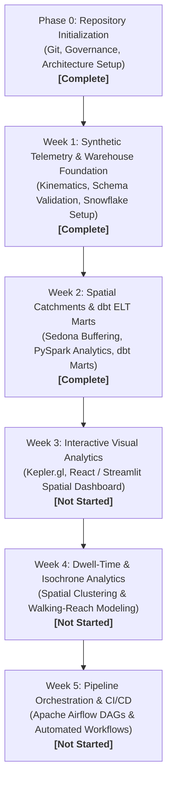

# GeoPulse: Project Charter

## 1. Project Information

| Field | Detail |
| :--- | :--- |
| **Project Name** | GeoPulse: Hyper-Local Retail Mobility Analytics |
| **Domain** | Retail Strategy, Geospatial Engineering, and Urban Mobility Analytics |
| **Repository** | `https://github.com/dileep-songa/geopulse-hyperlocal-retail-mobility-analytics` |
| **Author / Lead** | Dileep Songa (Internship Project) |
| **Project Stage** | **Week 2 complete — data foundation, spatial analytics and dbt ELT delivered. Week 3 not started.** |
| **Target Audience** | Data Engineering Evaluators, Geospatial Architects, Retail Analytics Leads |

---

## 2. Problem Statement

Retail store network planning and commercial corridor optimization require granular, timely insights into human mobility. Understanding how consumers move through physical spaces—which retail corridors they frequent, how long they linger, and where store catchment zones overlap—is vital for competitive survival.

Historically, organizations have relied on:
- **Static Decennial Census Data**: Reliable for broad demographics, but completely disconnected from intra-day, weekday/weekend, or seasonal foot traffic patterns.
- **Internal Point-of-Sale (POS) Logs**: Highly accurate for paying customers inside a specific store, but blind to prospective customers walking past the storefront or patronizing adjacent competitors.
- **Commercial Aggregated GPS Telemetry**: Prohibitively expensive (often hundreds of thousands of dollars annually), legally perilous under GDPR/CCPA, and fraught with vendor lock-in and shifting attribution methodologies.

Furthermore, multi-unit retail brands face significant risk of **store cannibalization**: opening a new location that pulls customers away from an existing branch rather than capturing net-new market share. Retailers lack open, reproducible data engineering frameworks capable of modeling spatial catchment overlap and cannibalization dynamics without immense commercial licensing fees.

---

## 3. Proposed Solution

**GeoPulse** is an end-to-end geospatial intelligence platform powered by mathematically modeled, synthetic mobile mobility observations. The platform simulates realistic urban pedestrian and vehicular trajectories, processes spatial interactions at scale, and loads the data into a modern cloud data warehouse for analytical modeling and spatial visualization.

By coupling synthetic data simulation with modern data engineering tooling:
1. **Privacy-Conscious Architecture**: Completely eliminates real-world consumer tracking and PII handling by relying exclusively on synthetic trajectory simulation. (Note: While this synthetic architecture eliminates personal data collection by design, it represents an engineering choice rather than an automatic legal compliance guarantee or formal statutory certification).
2. **Open Architectural Pattern**: Demonstrates a complete reference architecture connecting distributed spatial computing (Apache Sedona / PySpark), cloud data warehousing (Snowflake), transformation and data testing (dbt), and geospatial visualization (Kepler.gl / React).
3. **Actionable Retail Intelligence**: Computes store catchment zones, visit duration distributions, footfall volume heatmaps, and spatial cannibalization metrics for retail networks using simulated telemetry.

---

## 4. Objectives

### 4.1 Completed Engineering & Analytical Objectives (Weeks 1 & 2)

- **Deterministic Synthetic Telemetry Engine (Week 1)**:
  - Generates 10,000 synthetic GPS observations for 500 simulated devices within Indiranagar, Bengaluru ($[77.6250, 77.6550]^\circ\text{E}, [12.9650, 12.9900]^\circ\text{N}$) with velocity-bounded kinematics, diurnal curves, and dwell anchoring under deterministic seed `42`.
- **Independent Data Quality Validation Engine (Week 1)**:
  - Strict canonical schema enforcement (8 columns), geodetic boundary assertions, velocity anomaly detection, and identifier uniqueness. Verified via 36 unit tests.
- **Cloud Warehousing Infrastructure & Ingestion (Week 1 & 2)**:
  - Structured Snowflake warehouse (`GEOPULSE_DB`) with dedicated schemas (`RAW`, `STAGING`, `ANALYTICS`), file format, and internal stage. Ingested raw observations via `COPY INTO` and generated native `GEOGRAPHY` point geometries.
- **Distributed Spatial Catchment Processing (Week 2)**:
  - Projected geodetic coordinates into UTM Zone 43N (`EPSG:32643`) for planar metric accuracy.
  - Constructed 500-metre regular 32-gon buffer polygons around 4 hypothetical candidate retail stores (area ~780,361.29 m²; $ST\_IsValid = \text{true}$).
  - Executed spatial point-in-polygon containment joins via Apache Sedona/PySpark, matching exactly 4,051 memberships across 3,956 unique observations and 350 devices.
- **PySpark Retail Mobility Analytics (Week 2)**:
  - Converted UTC timestamps to Indian Standard Time (`Asia/Kolkata`, UTC+05:30), evaluated 4 diurnal dayparts (`morning`, `afternoon`, `evening`, `night`), and produced baseline CSV datasets across 81 store-hours, 16 store-diurnals, 8 store-days, and 4 store exclusivity summaries.
- **Snowflake dbt ELT Dimensional Modeling (Week 2)**:
  - Authored and materialized 6 dbt models in `GEOPULSE_DB.ANALYTICS`: 2 views (`stg_store_catchment_memberships`, `int_store_memberships_overlap_tagged`) and 4 dimensional tables (`fct_hourly_store_activity`, `fct_store_time_of_day_activity`, `fct_daily_store_summary`, `fct_store_overlap_summary`).
  - Isolated multi-catchment overlap flags with zero Cartesian fan-out (preserved exact 4,051 membership grain).
- **Exact Cross-Platform Parity Verification (Week 2)**:
  - Verified 100% exact numerical and relational parity (`max_abs_diff = 0.0`) between Snowflake dbt tables and PySpark baseline CSVs across all rows, dimensions, and metrics.
- **Comprehensive Automated Testing (Weeks 1 & 2)**:
  - 163 Python unit/integration tests passing in 1.21s (0 failures, 0 errors).
  - 65 dbt tests passing in 73.84s (10 source, 49 schema, 6 singular integration tests).
  - Total automated verification suite: **228 automated tests passing**.

### 4.2 Remaining & Planned Objectives (Weeks 3–6 — Not Started)

- **Interactive Geospatial Visualization (Planned — Week 3)**:
  - Build an exploratory web dashboard utilizing React, Kepler.gl, and Streamlit to render dynamic 3D heatmaps, animated trip playback, and alpha-blended catchment overlap corridors.
- **Advanced Dwell-Time & Stay-Point Classification (Planned — Week 4)**:
  - Implement temporal clustering algorithms to distinguish transient transit traffic from lingering physical retail store visits based on dwell duration thresholds.
- **Pedestrian-Network Isochrone Modeling (Planned — Week 4)**:
  - Incorporate OpenStreetMap street network routing to construct realistic walking-distance and travel-time isochrones rather than circular planar buffers.
- **Production Pipeline Orchestration (Planned — Week 5/6)**:
  - Author Apache Airflow DAGs to automate synthetic data generation, Sedona processing, Snowflake staging, and dbt transformation runs with retry policies and SLA alerting.

---

## 5. Functional Scope

### 5.1 Completed Scope (Weeks 1 & 2)
- **Synthetic Mobility Simulation**:
  - Deterministic Python simulation engine (`src/data_generator.py`) generating 10,000 pings across 500 devices.
  - Configurable bounding box over Indiranagar, Bengaluru ($[77.6250, 77.6550]^\circ\text{E}, [12.9650, 12.9900]^\circ\text{N}$).
  - Velocity-bounded kinematics (walking 0.8–1.6 m/s, transit 3.5–14.0 m/s, dwell $\le 0.30$ m/s), dwell anchoring, and predictive boundary reflection.
- **Data Quality & Validation**:
  - Independent validation module (`src/data_quality.py`) with 36 automated unit tests.
  - Strict 8-column schema conformance, UUIDv4 uniqueness, coordinate range bounds, and temporal sequence validation.
- **Spatial Data Engineering**:
  - Planar coordinate projection from WGS 84 (`EPSG:4326`) to UTM Zone 43N (`EPSG:32643`).
  - Metric 500-metre circular buffer generation (32-sided regular polygon) around 4 candidate store centroids.
  - Point-in-polygon containment joins and Euclidean distance calculations via Apache Sedona/PySpark.
- **Cloud Warehousing & dbt ELT Modeling**:
  - Snowflake database, stage, and table provisioning (`GEOPULSE_DB`).
  - Staging view (`stg_store_catchment_memberships`) with IST timestamp conversion and diurnal classification.
  - Intermediate view (`int_store_memberships_overlap_tagged`) with independent ping- and device-overlap tagging.
  - Four commercial retail marts (`fct_hourly_store_activity`, `fct_store_time_of_day_activity`, `fct_daily_store_summary`, `fct_store_overlap_summary`).
  - 65 dbt tests enforcing schema integrity, referential constraints, and reconciliation invariants.

### 5.2 Planned Future Scope (Weeks 3–6 — Not Started)
- Interactive web frontend (React + Kepler.gl / Streamlit).
- Graph routing and walking isochrones via OpenStreetMap (OSM) street networks.
- Spatial clustering algorithms for dwell-point extraction.
- End-to-end Apache Airflow workflow orchestration.

### 5.3 Out-of-Scope (All Phases)
- Ingestion of real-world consumer cellular telemetry, Call Detail Records (CDRs), or real Mobile Advertising IDs (MAIDs).
- Integration with live commercial point-of-sale (POS) transactional hardware or enterprise ERP backends.
- Real-time sub-second streaming inference (the project focuses on high-throughput micro-batch and scheduled analytical pipelines).
- Multi-million-dollar proprietary commercial street network licensing.

---

## 6. Technology Stack & Operational Status

| Layer | Component | Target Tool | Operational Status | Role in GeoPulse |
| :--- | :--- | :--- | :--- | :--- |
| **Language** | Python | 3.12+ | **Implemented (Weeks 1 & 2)** | Synthetic trajectory generation, data quality validation, unit testing, and analytical verification |
| **Distributed Spatial** | PySpark & Sedona | Spark 3.5+ / Sedona 1.9+ | **Implemented (Week 2)** | Distributed planar projection (UTM 43N), 500m buffer generation, and spatial point-in-polygon joins |
| **Data Warehouse** | Snowflake | Standard Edition | **Implemented (Weeks 1 & 2)** | Cloud analytical store, native `GEOGRAPHY` point modeling, raw landing tables, and analytics schema |
| **Transformation** | dbt | dbt-core 1.12.7 / dbt-snowflake 1.12.5 | **Implemented (Week 2)** | Modular dimensional modeling (2 views, 4 tables), schema testing, and cross-platform metric validation |
| **Presentation** | Kepler.gl & React | React 18+ / Kepler.gl | *Planned (Week 3 — Not Started)* | High-performance GPU-accelerated spatial visualization and interactive dashboard |
| **Orchestration** | Apache Airflow | Airflow 2.8+ | *Planned (Week 5/6 — Not Started)* | Automated pipeline execution, dependency DAGs, backfill management, and alerting |
| **Environment & QA** | Git, Pytest, EditorConfig | Git / GitHub | **Implemented (Weeks 1 & 2)** | Version control, branch isolation, automated test assertions (228 automated tests passing) |

---

## 7. Data Governance and Ethics

1. **100% Synthetic Data Policy**:
   - Every coordinate, timestamp, device identifier, and trajectory attribute is generated algorithmically.
   - The dataset contains zero records derived from physical mobile devices, telemetry aggregators, or individual tracking.
2. **Schema Contracts**:
   - Upstream telemetry generators produce strictly typed CSV records adhering to documented schemas (`device_id` as UUID, `event_timestamp` as UTC ISO-8601, `latitude`/`longitude` in WGS 84).
3. **Data Retention & Lifecycle**:
   - Raw simulated telemetry files are reproducible staging assets that can be regenerated on demand via deterministic random seed `42`.
   - Gold analytical marts are materialized in Snowflake and cataloged through dbt models.

---

## 8. Expected Deliverables

| Deliverable | Description | Status |
| :--- | :--- | :--- |
| **1. Synthetic Telemetry Generator Engine** | Python simulation engine generating deterministic mobility data with customizable volumes and urban bounding areas (`src/data_generator.py`). | **Delivered (Week 1)** |
| **2. Data Quality & Validation Engine** | Automated validation module asserting schema compliance, geodetic boundaries, and kinematic velocities (`src/data_quality.py`). | **Delivered (Week 1)** |
| **3. Distributed Spatial Computing Pipeline** | PySpark/Apache Sedona scripts executing planar projection (EPSG:32643) and 500m buffer joins (`src/spatial_analysis.py`). | **Delivered (Week 2)** |
| **4. Retail Mobility Analytics Engine** | PySpark analytical engine calculating hourly activity, diurnal patterns, daily summaries, and overlap distributions (`src/retail_mobility_analytics.py`). | **Delivered (Week 2)** |
| **5. Snowflake Database & dbt Project** | Complete Snowflake infrastructure, 6 dbt models (2 views, 4 tables), and 65 automated dbt tests (`dbt/geopulse_analytics/`). | **Delivered (Week 2)** |
| **6. Interactive Geospatial Dashboard** | React + Kepler.gl / Streamlit web application visualizing pedestrian density heatmaps and store catchment polygons. | *Planned (Week 3 — Not Started)* |
| **7. Airflow Orchestration DAGs** | Production Airflow workflows orchestrating simulation, processing, warehouse ingestion, and transformation tasks. | *Planned (Week 5/6 — Not Started)* |
| **8. Milestone Reports & Documentation** | Detailed milestone completion reports documenting engineering benchmarks, test evidence, and metric reconciliation. | **Delivered (Weeks 1 & 2)** |

---

## 9. Project Limitations and Analytical Assumptions

- **Synthetic Trajectory Heuristics**: The generator models agent motion via velocity-bounded random walks with dwell anchoring and predictive boundary steering; it does not simulate physical road-network turn restrictions or multi-agent traffic congestion.
- **Predictive Boundary Steering**: Boundary reflection is an algorithmic simulation rule to keep generated agents within the study envelope, not physical vehicular navigation.
- **Synthetic Baseline vs. Real Demand**: No observed human footfall or real-world consumer transactions are measured; all outputs represent synthetic simulations for engineering evaluation.
- **Spatial Proximity vs. Store Visits**: Catchment membership denotes geometric presence within a 500-metre planar radius, not physical commercial entry, verified dwell, or retail purchases.
- **Catchment Overlap vs. Cannibalization**: Multi-catchment observations indicate shared geographic proximity between adjacent buffers, not brand switching, shared customer loyalty, or commercial cannibalization.
- **Planar Buffer Approximation**: Catchments are planar circular buffers in UTM Zone 43N (`EPSG:32643`), not street-network walking isochrones or building-constrained footprints.

---

## 10. Incremental Development Methodology & Current Milestones

### Current Milestone Status Table

| Milestone | Target Scope | Status | Verification & Deliverables |
| :--- | :--- | :---: | :--- |
| **Phase 0** | Repository Initialization & Architecture | **Complete** | Git setup, `.editorconfig`, `.gitignore`, `docs/PROJECT_CHARTER.md`, `docs/TECHNICAL_OVERVIEW.md` |
| **Week 1** | Synthetic Telemetry Engine & Snowflake Foundation | **Complete** | 10,000 pings, 500 devices, seed 42, `src/data_generator.py`, `src/data_quality.py`, Snowflake DDL, 65 Python tests |
| **Week 2** | Spatial Catchment Analytics & Snowflake dbt ELT Marts | **Complete** | Sedona 500m planar buffers, 4,051 memberships, PySpark analytics, 6 dbt models, 4 marts, 65 dbt tests, 163 Python tests (228 total tests passing), 100% Spark-to-Snowflake metric reconciliation |
| **Week 3** | Interactive Geospatial Visualization & Dashboard | **Not Started** | Kepler.gl / React web application, trajectory playback, catchment overlap exploration |
| **Week 4** | Advanced Dwell-Time & Isochrone Analytics | **Not Started** | Spatial dwell clustering, street-network walking isochrones |
| **Week 5** | Airflow Orchestration & Pipeline Automation | **Not Started** | Apache Airflow DAGs, automated data pipelines, SLA monitoring |
| **Week 6** | End-to-End Hardening, Benchmarking & Final Delivery | **Not Started** | Comprehensive performance benchmarks, final capstone presentation |
