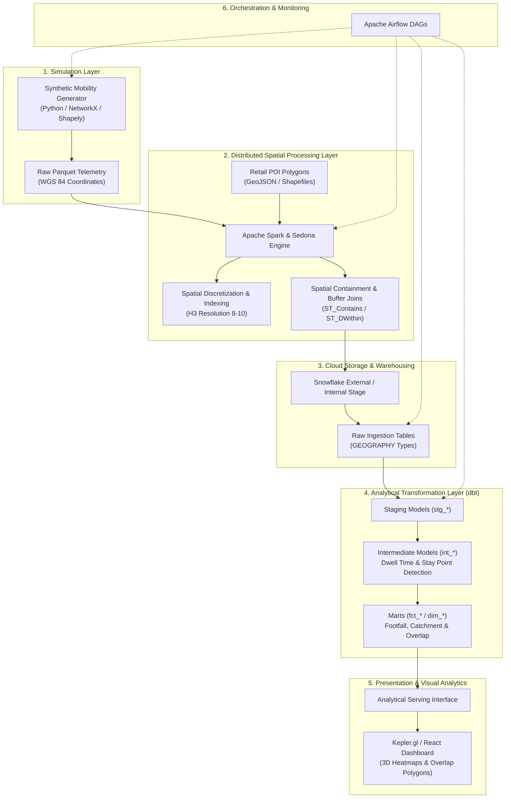
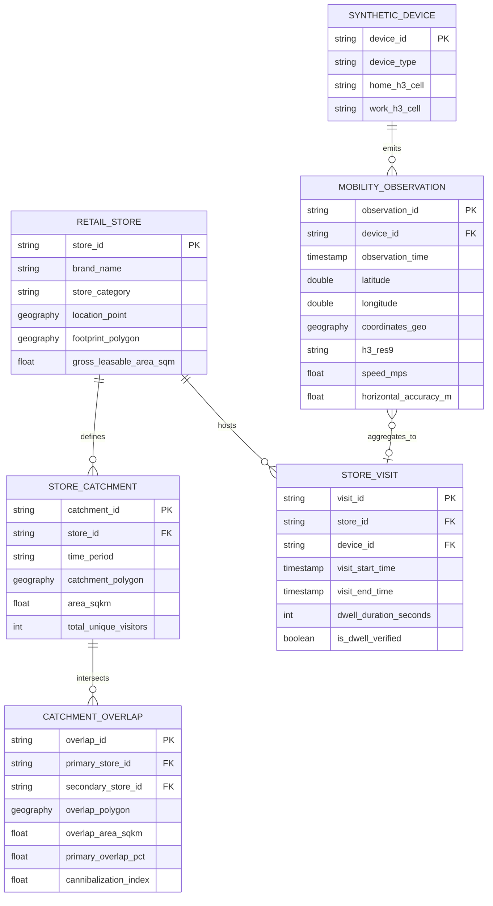

# GeoPulse: Technical Architecture and System Overview

This document provides the technical design, architectural patterns, data modeling specifications, and implementation roadmap for **GeoPulse: Hyper-Local Retail Mobility Analytics**.

---

## 1. System Architecture and Component Overview

The GeoPulse platform processes synthetic mobility telemetry through a modern, decoupled data engineering stack:

---

## 2. Component Technical Deep-Dives

### 2.1 Synthetic Data Generation
The synthetic mobility generation engine produces deterministic, realistic urban movement trajectories without real-world telemetry dependencies:

- **Current Implementation (Week 1 Day 1 & Day 2 — `src/data_generator.py`)**:
  - Implemented entirely with Python standard-library modules (`math`, `random`, `datetime`, `uuid`, `csv`), requiring zero external dependencies for development agility and testability.
  - **Temporal Budgeting & Activity Windows**: Enforces exact Day 1 diurnal activity windows defined in `Asia/Kolkata` (Morning 08:00–11:00, Midday 11:30–15:30, Evening 17:00–21:30, Night 22:00–07:00 crossing midnight) with pre-planned trajectory timestamp budgeting ensuring zero observations spill into excluded non-activity gaps.
  - **Physical Kinematics**: Enforces strict velocity-bounded movement: walking ($0.8\text{--}1.6\text{ m/s}$), vehicular transit ($3.5\text{--}14.0\text{ m/s}$), and stationary dwell ($\le 0.30\text{ m/s}$).
  - **Dwell Anchoring & Sensor Noise**: Anchors devices at simulated retail POIs with realistic GPS positional uncertainty ($2.0\text{--}35.0\text{ m}$) and localized jitter displacement ($0.5\text{--}3.0\text{ m}$).
  - **Predictive Inward Boundary Steering**: Heading vectors are predictively reflected inward before displacement when nearing bounding perimeters, preserving exact physical step distance and speed without coordinate truncation or abrupt teleportation.
  - **Day 1 Canonical Schema Contract**: Generates canonical CSV records with 8 strictly typed fields: `ping_id`, `device_id`, `event_timestamp` (ISO-8601 UTC with `Z`), `latitude` (6 decimals), `longitude` (6 decimals), `accuracy_meters`, `movement_mode`, and `data_provenance` (`geopulse_synthetic_v1`).

- **Planned Extensions (Subsequent Milestones)**:
  - Integration with OpenStreetMap (OSM) road network graphs (NetworkX / OSMnx) for street-edge snapping and shortest-path routing (Dijkstra / A*).
  - Gravity interaction models simulating commercial attraction between competing cafe clusters.
  - Apache Parquet columnar serialization and partitioning during Week 2 distributed spatial engine integration.

### 2.2 PySpark and Apache Sedona Spatial Processing
Large-scale spatial filtering and geometric joins cannot scale efficiently on single-node Python processes. GeoPulse leverages PySpark accelerated by Apache Sedona:

- **Distributed Spatial Partitioning**:
  - Utilizes KDB-Tree and R-Tree spatial partitioners to divide geographical bounding boxes across Spark executors while maintaining spatial locality.
- **Geospatial SQL Acceleration**:
  - Evaluates spatial predicates (`ST_Contains`, `ST_Within`, `ST_DistanceSphere`, `ST_Buffer`) using optimized C++/Java spatial index bindings.
- **Hexagonal Spatial Indexing (H3)**:
  - Bins continuous coordinate pairs into discrete hexagonal cells (Uber H3 Index at resolution 8 [~460m] for corridor overviews, resolution 9 [~174m] for block level, and resolution 10 [~65m] for store-front proximity).
- **Trajectory Aggregation & Map Matching**:
  - Groups sequential breadcrumbs by `device_id` and temporal windows to reconstruct movement vectors and identify trip endpoints.

### 2.3 Snowflake Geospatial Storage
Snowflake serves as the centralized analytical data warehouse:

- **Native Geospatial Datatypes**:
  - Uses Snowflake's native `GEOGRAPHY` data type, modeling features on the WGS 84 ellipsoidal surface and enabling spherical distance calculations without local projection distortion.
  - Selectively uses `GEOMETRY` for planar cadastral boundary operations.
- **Storage & Clustering Strategy**:
  - Organizes raw telemetry tables clustered by `DATE(timestamp)` and `H3_CELL_ID` to optimize micro-partition pruning for spatial-temporal range queries.
- **Ingestion Mechanisms**:
  - Parquet staging via internal/external stages using vectorized `COPY INTO` commands with automated schema validation.

### 2.4 dbt Transformations
The analytical modeling layer is authored in dbt (data build tool), structured around a medallion architecture:

- **Staging (`stg_`)**:
  - Standardizes raw column types, applies UTC normalization, and validates coordinate boundaries.
- **Intermediate (`int_`)**:
  - **Dwell Time Detection**: Groups consecutive observation points within a spatial radius ($\Delta d \le 30\text{m}$) over a minimum time window ($\Delta t \ge 5\text{ min}$) to classify "dwell visits" vs. "drive-by pass-throughs".
  - **Catchment Polygon Generation**: Constructs convex/concave hulls (`ST_CONVEXHULL`) representing the observed spatial distribution of visiting devices.
- **Marts (`fct_` & `dim_`)**:
  - `dim_retail_stores`: Store profile, brand, commercial zone, and store boundary polygon.
  - `fct_hourly_footfall`: Aggregated visit counts, unique device counts, and average dwell times segmented by hour and retail brand.
  - `fct_catchment_overlap`: Pairwise store intersection areas ($\text{Area}(C_A \cap C_B)$) and device cannibalization percentages.
- **Automated Testing**:
  - Enforces schema assertions, non-null guarantees, referential integrity, and custom spatial tests (e.g., verifying latitude $[-90, 90]$ and longitude $[-180, 180]$).

### 2.5 React and Kepler.gl Visualization
The presentation tier provides an interactive, exploratory web interface:

- **Kepler.gl Integration**:
  - Leverages Deck.gl and WebGL to render tens of thousands of spatial points, trajectories, and polygons smoothly at 60 FPS in the browser.
- **Core Visual Layers**:
  - **Hexbin Heatmaps**: Aggregated foot traffic intensity across H3 hexagonal cells.
  - **Trip Playback**: Temporal animation of synthetic device journeys over commercial corridors.
  - **Catchment Overlap Visualizer**: Dynamic alpha-blended polygon overlays highlighting retail cannibalization corridors.
- **User Controls**:
  - Time-range scrubbing, day-of-week filters, brand isolation selectors, and dwell-duration sliders.

### 2.6 Apache Airflow Orchestration
Apache Airflow automates the end-to-end data lifecycle:

- **Pipeline Workflows (DAGs)**:
  - `geopulse_daily_simulation`: Triggers the synthetic telemetry generator for the target date partition.
  - `geopulse_sedona_spatial_etl`: Submits the PySpark/Sedona spatial indexing and boundary-join job.
  - `geopulse_snowflake_stage_and_load`: Executes automated COPY INTO commands to ingest staged Parquet files.
  - `geopulse_dbt_transform_and_test`: Runs dbt models and executes automated test suites.
- **Resilience & Governance**:
  - Configured with retries, exponential backoff, Slack/email alert webhooks, and strict execution SLAs.

---

## 3. Proposed Data Entities and Schemas

---

## 4. Implementation Status: Planned vs. Implemented Components

To maintain transparent engineering governance, all platform components are classified below by operational status:

| Architectural Component | Subsystem / Asset | Status | Notes |
| :--- | :--- | :--- | :--- |
| **Repository Foundation** | Git configuration, `.gitignore`, `.gitattributes`, `.editorconfig` | **Implemented** | Universal standards, LF line ending normalization, clean git tracking setup. |
| **Governance & Documentation** | `PROJECT_CHARTER.md`, `TECHNICAL_OVERVIEW.md`, `README.md` | **Implemented** | Complete scope, data contracts, and architectural specs. |
| **Directory Structure** | `data/` (`raw`, `processed`, `reference`), `src/`, `sql/`, `tests/`, `reports/` | **Implemented** | Directories created and preserved via `.gitkeep`. |
| **Week 1 Day 1 Specification** | Data specification, study area bounding box, schema contract | **Implemented** | Authored in `src/config.py`, documented in `docs/DATA_DICTIONARY.md`, tested in `tests/test_study_area_spec.py`. |
| **Week 1 Day 2 Synthetic Generator** | Python trajectory generator, kinematic engine, boundary steering | **Implemented** | Engine in `src/data_generator.py`, test suite in `tests/test_data_generator.py`, report in `reports/WEEK1_DAY2_GENERATION_REPORT.md`. |
| **Week 1 Day 3: Data Quality and Mobility Validation** | Primary: missing values, duplicates, coordinate bounds, timestamp consistency, device chronology, speed limits, interval compliance, and trajectory validation; Supporting: exploratory spatial distribution summaries | *Pending (Week 1 Day 3)* | Next scheduled milestone. |
| **Distributed Spatial Engine** | PySpark / Sedona spatial joins, H3 binning jobs | *Planned (Week 2)* | Cluster configuration and Spark jobs to be authored in `src/`. |
| **Snowflake Warehouse Layer** | Stage DDLs, raw/staging table definitions, clustering keys | *Planned (Week 3)* | SQL DDL scripts to be authored in `sql/`. |
| **dbt Transformation Models** | Staging, intermediate dwell detection, gold footfall & overlap marts | *Planned (Week 4)* | dbt project initialization and model authoring. |
| **Kepler.gl / React Frontend** | Interactive web application, layer controls, trajectory playback | *Planned (Week 5)* | Web application development. |
| **Airflow Orchestration** | Production DAGs, sensor operators, SLA monitors | *Planned (Week 6)* | DAG definitions and scheduling infrastructure. |

---

## 5. Security, Credential Management & Quality Assurance

- **Zero Hardcoded Secrets**: All cloud infrastructure endpoints (Snowflake account identifiers, credentials) will be passed exclusively through environment variables and local `.env` files (enforced by `.gitignore`).
- **Data Quality Gates**: Every transformation pipeline incorporates assertions verifying geometry validity (`ST_ISVALID`), non-null spatial coordinates, and referential integrity between visits and retail stores.
- **Deterministic Testing**: Unit and integration test suites in `tests/` will use fixed random seeds and mock reference geometries to ensure rapid, reproducible CI/CD execution without external cloud dependencies.
