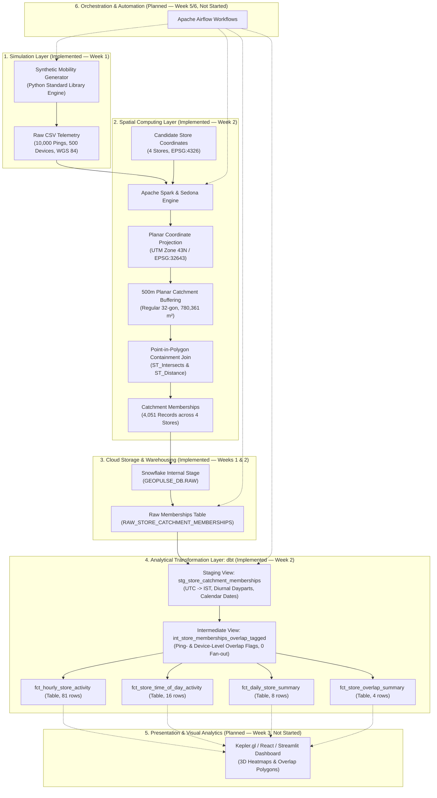
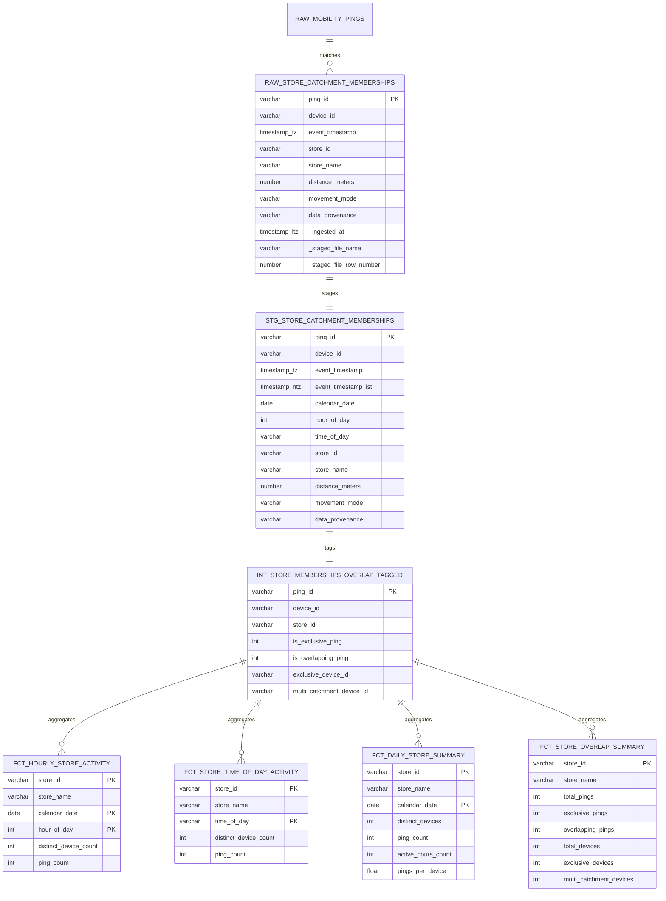

# GeoPulse: Technical Architecture and System Overview

This document provides the technical design, architectural patterns, data modeling specifications, and implementation roadmap for **GeoPulse: Hyper-Local Retail Mobility Analytics**.

---

## 1. System Architecture and Component Overview

The GeoPulse platform processes synthetic mobility telemetry through a modern, decoupled geospatial data engineering stack:

---

## 2. Component Technical Deep-Dives

### 2.1 Synthetic Mobility Generation (Implemented — Week 1)
The synthetic mobility generator produces deterministic, realistic urban movement trajectories without relying on real-world telemetry or handling personal data:

- **Engine Architecture (`src/data_generator.py`)**:
  - Implemented entirely with Python standard-library modules (`math`, `random`, `datetime`, `uuid`, `csv`), requiring zero external runtime dependencies.
  - **Temporal Budgeting & Activity Windows**: Enforces diurnal activity windows in local Indian Standard Time (`Asia/Kolkata`): Morning (08:00–11:00), Midday (11:30–15:30), Evening (17:00–21:30), and Night (22:00–07:00 crossing midnight). Trajectory timestamps are pre-budgeted so zero observations spill into excluded non-activity gaps.
  - **Physical Kinematics**: Enforces strict velocity-bounded movement: walking ($0.8\text{--}1.6\text{ m/s}$), vehicular transit ($3.5\text{--}14.0\text{ m/s}$), and stationary dwell ($\le 0.30\text{ m/s}$).
  - **Dwell Anchoring & Sensor Noise**: Anchors devices at commercial points of interest with realistic GPS positional uncertainty ($2.0\text{--}35.0\text{ m}$) and localized jitter displacement ($0.5\text{--}3.0\text{ m}$).
  - **Predictive Inward Boundary Steering**: Heading vectors are predictively reflected inward before displacement when nearing bounding perimeters, preserving exact physical step distance and speed without coordinate truncation or abrupt teleportation.
  - **Canonical Schema Contract**: Produces canonical CSV records with 8 strictly typed fields: `ping_id`, `device_id`, `event_timestamp` (ISO-8601 UTC with `Z`), `latitude` (6 decimals), `longitude` (6 decimals), `accuracy_meters`, `movement_mode`, and `data_provenance` (`geopulse_synthetic_v1`).
  - **Deterministic Seed**: Seed `42` ensures bitwise-reproducible CSV outputs (`data/raw/synthetic_mobility_pings.csv`, SHA-256: `a5070e6a0d94ba6ddc23151564c42d1365d0453cde83c55513f4cda14a124aa8`).

### 2.2 Distributed Spatial Processing & Retail Analytics (Implemented — Week 2)
Spatial buffering and geometric point-in-polygon containment joins are executed using Apache Sedona and PySpark:

- **Planar Coordinate Projection (`src/spatial_analysis.py`)**:
  - Geographic coordinates in WGS 84 (`EPSG:4326`) express positions on an ellipsoidal surface in angular degrees.
  - Coordinates are projected to Universal Transverse Mercator (UTM) Zone 43N (`EPSG:32643`), providing a conformal Cartesian coordinate plane measured in metres (Eastings and Northings) with minimal local distortion for Bengaluru.
- **Metric Planar Buffer Generation**:
  - A planar buffer with radius $r = 500.0\text{ m}$ is constructed around each candidate store point using `ST_Buffer`.
  - Apache Sedona approximates circular buffers using 8 segments per quadrant, creating a 32-sided regular polygon ($N = 32$). The theoretical area of this regular polygon is:
    $$A_{32} = 16 \cdot (500)^2 \cdot \sin\left(\frac{\pi}{16}\right) \approx 780,361.29\text{ m}^2$$
  - This area differs from a theoretical circle ($\pi r^2 \approx 785,398.16\text{ m}^2$) by only $0.64\%$. Geometry validity is verified using `ST_IsValid(catchment_geom)`.
- **Spatial Intersection & Proximity Joins**:
  - Membership is evaluated via `ST_Intersects(ping_geom_proj, catchment_geom)`.
  - For every matched observation, Euclidean planar distance to the store centroid is computed: `ROUND(ST_Distance(ping_geom_proj, store_geom_proj), 2)`.
  - Results: **4,051 matched membership records** across 3,956 unique observations and 350 distinct devices (`data/processed/store_catchment_memberships/`).
- **Retail Mobility Analytics (`src/retail_mobility_analytics.py`)**:
  - Converts timestamps to Indian Standard Time (`Asia/Kolkata`, UTC+05:30) and evaluates four retail dayparts:
    - Morning: 06:00–11:59 IST
    - Afternoon: 12:00–16:59 IST
    - Evening: 17:00–21:59 IST
    - Night: 22:00–05:59 IST
  - Computes baseline CSV datasets under `data/processed/week2_retail_analytics/` across 81 store-hours, 16 store-diurnals, 8 store-days, and 4 store overlap summaries.

### 2.3 Snowflake Cloud Data Warehousing (Implemented — Weeks 1 & 2)
Snowflake serves as the centralized analytical data warehouse:

- **Warehouse Architecture**:
  - Database: `GEOPULSE_DB`
  - Warehouse: `COMPUTE_WH`
  - Schemas: `RAW` (landing tables), `STAGING` (spatial preparation), `ANALYTICS` (dbt models and marts).
- **Week 1 Ingestion Foundation**:
  - `RAW_MOBILITY_PINGS`: Ingested 10,000 raw observations via `COPY INTO`.
  - `STG_SPATIAL_MOBILITY_PINGS`: Enriched raw pings with native Snowflake `GEOGRAPHY` point objects using `ST_MAKEPOINT(longitude, latitude)`.
- **Week 2 Catchment Membership Storage**:
  - `RAW_STORE_CATCHMENT_MEMBERSHIPS`: Landed 4,051 spatial membership records in `GEOPULSE_DB.RAW` matching the 11-column landing schema.

### 2.4 dbt ELT Dimensional Modeling (Implemented — Week 2)
The dbt transformation layer (`dbt/geopulse_analytics/`) structures raw catchment memberships into dimensional retail marts:

- **Staging Layer (`stg_store_catchment_memberships.sql`)**:
  - Materialized as a `view`.
  - Converts `event_timestamp` (UTC) to Indian Standard Time using `CONVERT_TIMEZONE('Asia/Kolkata', event_timestamp)::TIMESTAMP_NTZ`.
  - Derives `calendar_date`, `hour_of_day`, and assigns diurnal time-of-day categories (`morning`, `afternoon`, `evening`, `night`).
- **Intermediate Layer (`int_store_memberships_overlap_tagged.sql`)**:
  - Materialized as a `view`.
  - Implements independent CTEs (`ping_store_counts` and `device_store_counts`) to calculate ping-level multi-catchment overlap flags (`is_exclusive_ping`, `is_overlapping_ping`) and device-level multi-catchment memberships (`exclusive_device_id`, `multi_catchment_device_id`).
  - Preserves exact 1:1 join grain (4,051 rows) with zero Cartesian duplication.
- **Marts Layer (Materialized as Tables in `GEOPULSE_DB.ANALYTICS`)**:
  - `fct_hourly_store_activity` (81 rows): Hourly aggregated pings and distinct devices per store and date.
  - `fct_store_time_of_day_activity` (16 rows): Daypart aggregated footfall per store across 4 diurnal windows.
  - `fct_daily_store_summary` (8 rows): Daily summary metrics per store, active hours, and visit intensity (`pings_per_device`).
  - `fct_store_overlap_summary` (4 rows): Per-store exclusivity distributions, reporting exclusive and overlapping pings/devices.
- **Automated dbt Testing (65 Tests, 100% Pass Rate)**:
  - 10 source tests (`not_null`, `accepted_values` on `movement_mode` and `data_provenance`).
  - 49 schema tests (primary key uniqueness, foreign-key relationships, not-null constraints, and accepted values).
  - 6 singular SQL integration tests validating exact row counts, composite grain uniqueness, and reconciliation invariants ($exclusive + overlapping = total$).
- **Cross-Platform Metric Parity**:
  - Verified 100% exact numerical match (`max_abs_diff = 0.0`) between Snowflake dbt tables and PySpark baseline CSVs across all rows, columns, and metrics.

### 2.5 Planned Presentation & Visual Analytics (Planned — Week 3, Not Started)
The presentation layer will deliver an exploratory, interactive spatial interface:
- **Kepler.gl / React / Streamlit Integration**:
  - GPU-accelerated rendering of spatial points, trajectory animations, and alpha-blended catchment overlap corridors.
  - User controls for time-window scrubbing, brand filtering, and diurnal activity comparison.

### 2.6 Planned Pipeline Orchestration (Planned — Week 5/6, Not Started)
Apache Airflow DAGs will automate the end-to-end data lifecycle:
- DAGs for synthetic data generation, Sedona spatial processing, Snowflake staging, and dbt transformations.
- Execution SLAs, retry policies, and automated alerting webhooks.

---

## 3. Data Entities and Schemas

---

## 4. Implementation Status: Implemented vs. Planned Components

| Architectural Component | Subsystem / Asset | Status | Notes |
| :--- | :--- | :---: | :--- |
| **Repository Foundation** | Git configuration, `.gitignore`, `.gitattributes`, `.editorconfig` | **Implemented** | Universal standards, LF normalization, clean git tracking setup. |
| **Governance & Documentation** | `PROJECT_CHARTER.md`, `TECHNICAL_OVERVIEW.md`, `README.md`, `DATA_DICTIONARY.md` | **Implemented** | Complete scope, data contracts, and architectural specs. |
| **Directory Structure** | `data/` (`raw`, `processed`, `reference`), `src/`, `sql/`, `dbt/`, `tests/`, `reports/` | **Implemented** | Directories created and preserved via `.gitkeep` and git tracking. |
| **Synthetic Mobility Engine (Week 1)** | Python trajectory generator, kinematic simulation, boundary steering | **Implemented** | Engine in `src/data_generator.py`, test suite in `tests/test_data_generator.py`, 10,000 observations generated. |
| **Data Quality Validation (Week 1)** | Independent validation engine, strict CSV parsing, geodetic & temporal audits | **Implemented** | Module in `src/data_quality.py`, 36 unit tests in `tests/test_data_quality.py`. |
| **Snowflake Spatial Foundation (Week 1)** | Snowflake DDL definitions, WGS 84 spatial point modeling, GEOGRAPHY enrichment | **Implemented** | DDL in `sql/snowflake/`, `RAW_MOBILITY_PINGS` and `STG_SPATIAL_MOBILITY_PINGS` deployed and loaded. |
| **Distributed Spatial Computing (Week 2)** | Apache Sedona / PySpark planar projection (UTM 43N), 500m buffering, point-in-polygon join | **Implemented** | Module in `src/spatial_analysis.py`, 45 tests in `tests/test_spatial_analysis.py`, 4,051 memberships matched. |
| **Retail Mobility Analytics (Week 2)** | PySpark analytical engine calculating hourly activity, diurnal patterns, daily summaries, overlap | **Implemented** | Module in `src/retail_mobility_analytics.py`, 53 tests in `tests/test_retail_mobility_analytics.py`. |
| **Snowflake dbt ELT Modeling (Week 2)** | Modular dbt models (2 views, 4 tables) in `GEOPULSE_DB.ANALYTICS` | **Implemented** | Complete dbt project in `dbt/geopulse_analytics/`, 65 dbt tests passing (0 failures, 0 errors). |
| **Cross-Platform Reconciliation (Week 2)** | Row-by-row and metric-by-metric verification between Snowflake and PySpark | **Implemented** | 100% exact numerical match (`max_abs_diff = 0.0`) across all 4 marts. |
| **Interactive Visual Analytics (Week 3)** | Kepler.gl, React / Streamlit dashboard, trajectory playback, catchment overlays | *Planned (Week 3 — Not Started)* | Frontend application development. |
| **Dwell-Time & Isochrone Modeling (Week 4)** | Spatial dwell clustering, OpenStreetMap street-network walking isochrones | *Planned (Week 4 — Not Started)* | Advanced spatial algorithms. |
| **Airflow Pipeline Orchestration (Week 5/6)** | Production DAGs, sensor operators, SLA monitors, CI/CD automation | *Planned (Week 5/6 — Not Started)* | DAG authoring and orchestration setup. |

---

## 5. Security, Credential Management & Quality Assurance

- **Zero Hardcoded Secrets**: All cloud infrastructure endpoints and authentication credentials reside strictly outside version control in local profile configurations (`~/.dbt/profiles.yml`), protected by root and project-level `.gitignore` rules.
- **Data Quality Gates**: Every transformation pipeline incorporates assertions verifying geometry validity (`ST_ISVALID`), non-null spatial coordinates, composite key uniqueness, and reconciliation invariants ($exclusive + overlapping = total$).
- **Deterministic Testing**: Comprehensive regression suites use fixed random seed `42` and mock geometries to ensure rapid, reproducible execution. Current test status: **163 Python tests + 65 dbt tests = 228 automated tests passing**.
