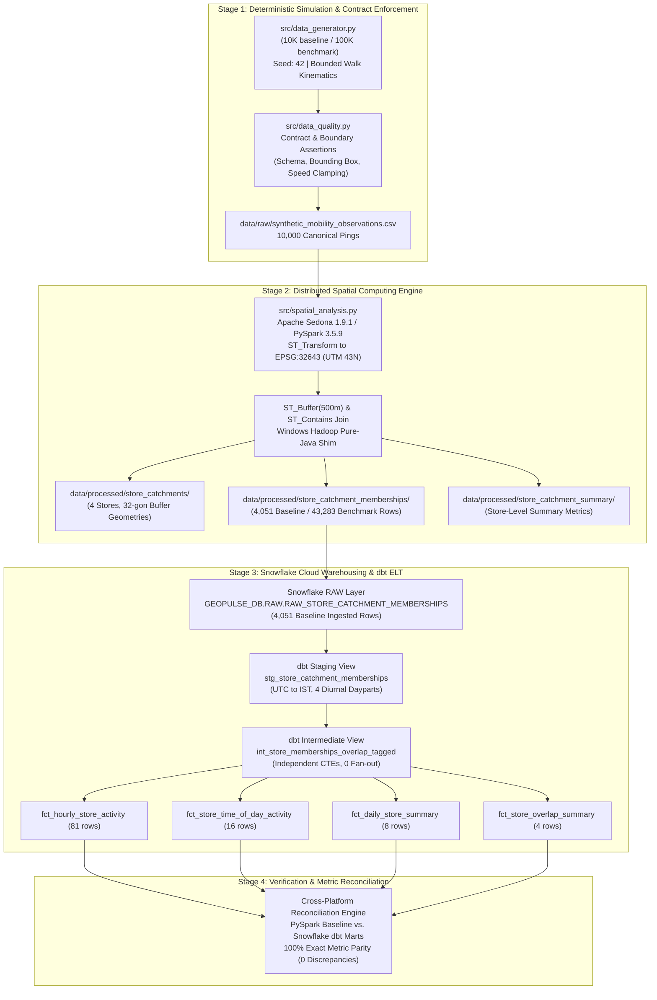
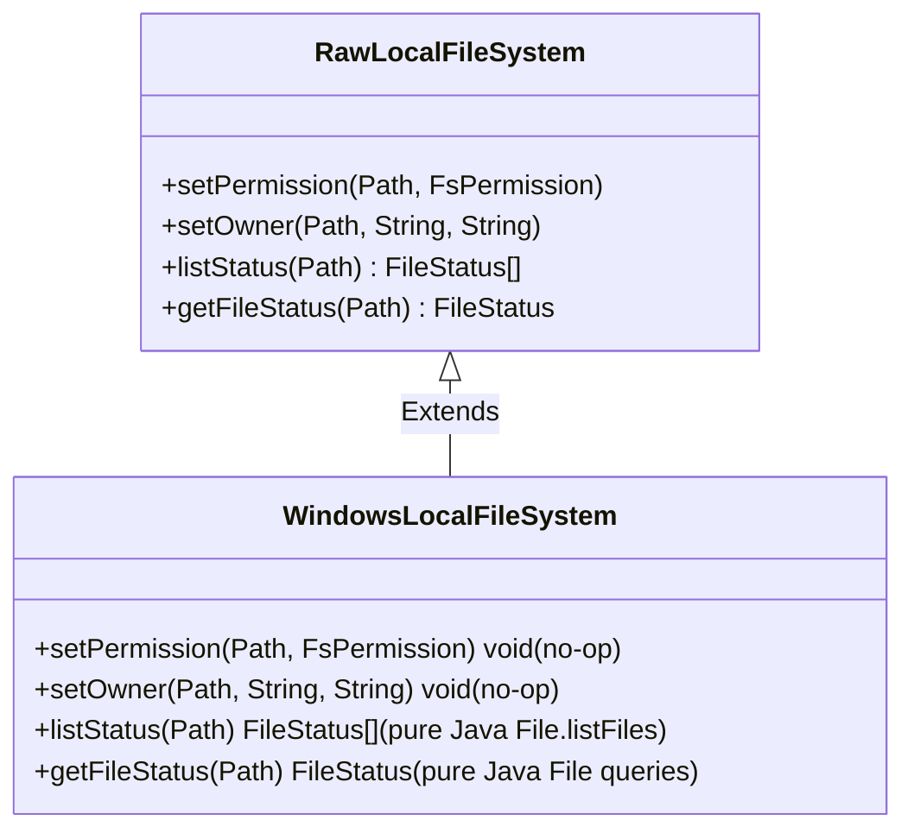
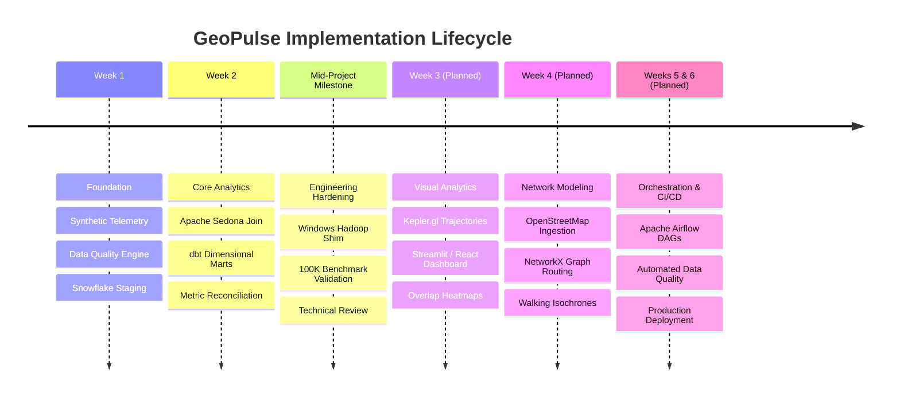

# GeoPulse: Mid-Project Technical Review and Milestone Audit

**Document Reference**: `reports/MID_PROJECT_TECHNICAL_REVIEW.md`<br/>
**Evaluation Scope**: Weeks 1 & 2 Execution, Windows Hadoop NativeIO Resolution, and 100K Local Spark Spatial Benchmark (Run 1)<br/>
**Target Audience**: Academic Reviewers, Technical Evaluators, and Engineering Leadership<br/>
**Project Repository**: `C:\project\geopulse-hyperlocal-retail-mobility-analytics`<br/>
**Execution Timestamp**: `2026-11-25T17:15:15Z` (Benchmark) / `2026-11-25` (Audit Review)<br/>
**Project Status**: **Week 1 & Week 2 Complete — Week 3 Not Started**

---

## Table of Contents

1. [Executive Summary & Review Purpose](#1-executive-summary--review-purpose)
2. [Business Problem & Geospatial Solution Context](#2-business-problem--geospatial-solution-context)
3. [Architecture & End-to-End Data Lineage](#3-architecture--end-to-end-data-lineage)
4. [Week 1 Deliverables & Technical Validation](#4-week-1-deliverables--technical-validation)
5. [Week 2 Deliverables & Technical Validation](#5-week-2-deliverables--technical-validation)
6. [Engineering Deep-Dive: Windows Hadoop Filesystem Shim](#6-engineering-deep-dive-windows-hadoop-filesystem-shim)
7. [100K Local Spark Spatial Benchmark (Run 1) Empirical Evidence](#7-100k-local-spark-spatial-benchmark-run-1-empirical-evidence)
8. [Baseline (10K) vs. Benchmark (100K) Architectural Distinctions](#8-baseline-10k-vs-benchmark-100k-architectural-distinctions)
9. [Verification & Automated Test Suites](#9-verification--automated-test-suites)
10. [Integrity, Originality & Academic Rigor](#10-integrity-originality--academic-rigor)
11. [Project Governance, Code Quality & Repository Standards](#11-project-governance-code-quality--repository-standards)
12. [Comprehensive Limitations & Analytical Disclaimers](#12-comprehensive-limitations--analytical-disclaimers)
13. [Future Roadmap: Weeks 3 to 6](#13-future-roadmap-weeks-3-to-6)
14. [Audit Sign-Off & Verification Metadata](#14-audit-sign-off--verification-metadata)

---

## 1. Executive Summary & Review Purpose

This technical review document provides a comprehensive, evidence-based milestone assessment of the **GeoPulse: Hyper-Local Retail Mobility Analytics** platform at the midpoint of its scheduled development lifecycle.

The primary purpose of this review is to validate the architectural integrity, engineering rigor, algorithmic originality, and data-lineage accuracy of all components completed during **Week 1 (Synthetic Telemetry & Snowflake Foundation)**, **Week 2 (Spatial Catchments & Snowflake dbt ELT)**, and the subsequent **100,000-record (100K) Local Spark Spatial Benchmark (Run 1)**.

### Current Milestone Status

- **Week 1 Status**: **Complete & Validated** (Deterministic kinematics, data-quality assertions, Snowflake native `GEOGRAPHY` staging).
- **Week 2 Status**: **Complete & Validated** (Apache Sedona spatial point-in-polygon containment joins, baseline retail analytics, 6 Snowflake dbt models across 4 dimensional marts with 100% metric parity).
- **Windows Hadoop Engineering Milestone**: **Complete & Validated** (Custom in-repo pure-Java filesystem shim resolving native C++ `winutils.exe` and `NativeIO$Windows.access0` dependencies without external binary downloads).
- **100K Local Spark Spatial Benchmark (Run 1)**: **Complete & Validated** (Single-node execution using `local[2]`; wall-clock 24.002s total / 12.701s pipeline; 43,283 verified catchment memberships; strict memory telemetry).
- **Week 3 Status**: **Not Started** (Interactive geospatial visualization via Kepler.gl, React, and Streamlit scheduled for subsequent sprints).

All statements, performance figures, memory metrics, and invariant equations contained in this report are backed by verified artifacts within the repository.

---

## 2. Business Problem & Geospatial Solution Context

Brick-and-mortar retail executives, urban spatial planners, and commercial real estate developers face high-consequence capital allocation decisions when siting physical stores, leasing commercial corridors, and evaluating store network cannibalization.

### Traditional Analytics Limitations

1. **Static Demographic Estimates**: Decennial census surveys provide coarse residential population counts, failing to model dynamic pedestrian volume, commuter corridors, or weekend footfall shifts.
2. **Point-of-Sale (POS) Blindspots**: Internal transactional logs record only finalized purchases at existing stores, offering zero visibility into passersby, uncaptured foot traffic, or competitor trade-area absorption.
3. **Commercial Telemetry Constraints**: Commercial mobile location data (e.g., Mobile Advertising IDs / MAIDs) carries prohibitive licensing fees, variable sampling biases, and stringent regulatory liabilities under GDPR, CCPA, and India's Digital Personal Data Protection Act (DPDPA).
4. **Cannibalization Risks**: Opening retail locations in close geographic proximity risks self-cannibalization unless multi-catchment overlap corridors are rigorously quantified.

### The GeoPulse Geospatial Approach

GeoPulse resolves these challenges through a privacy-preserving synthetic data architecture combined with an enterprise-grade spatial data engineering pipeline focused on the commercial district of **Indiranagar, Bengaluru, India**:

- **Deterministic Kinematic Generation**: Simulates 100% synthetic, privacy-preserving pedestrian trajectories using bounded walk algorithms, speed clamping, and dwell anchoring.
- **Metric-Accurate Planar Containment**: Re-projects geodetic coordinates ($WGS\ 84$ / $\text{EPSG:4326}$) to the metric Universal Transverse Mercator grid ($UTM\ Zone\ 43N$ / $\text{EPSG:32643}$), applying 500-metre circular buffers around candidate retail locations.
- **Dual-Engine Dimensional Modeling**: Integrates Apache Sedona distributed spatial computation with Snowflake dbt dimensional warehousing, verifying exact cross-platform metric reconciliation.

---

## 3. Architecture & End-to-End Data Lineage

The GeoPulse data architecture spans data simulation, quality enforcement, distributed spatial computation, and dimensional cloud data warehousing:



### Analytical Lineage Details:
1. **Simulation**: Generates timestamped geodetic coordinates within Indiranagar bounding coordinates ($12.9600^\circ\text{N}$ to $12.9850^\circ\text{N}$, $77.6250^\circ\text{E}$ to $77.6550^\circ\text{E}$).
2. **Planar Transformation**: Projects points from WGS 84 geodetic coordinates to UTM Zone 43N metric planar coordinates.
3. **Buffer Generation**: Generates 500-metre regular 32-polygon buffers centered at candidate retail coordinates.
4. **Containment Filtering**: Executes `ST_Contains` spatial joins to isolate devices moving within candidate trade areas.
5. **Dimensional Marts**: Structures analytical tables by time of day, hourly volume, daily aggregates, and catchment overlap exclusivity.

---

## 4. Week 1 Deliverables & Technical Validation

Week 1 established the synthetic mobility framework, spatial specifications, data quality verification engine, and Snowflake schema infrastructure.

### Summary of Week 1 Deliverables

| Component | Repository Path | Validation Evidence | Status |
| :--- | :--- | :--- | :---: |
| **Spatial Specification** | `src/config.py`, `docs/DATA_DICTIONARY.md` | Bounding box, CRS definitions, speed limits | **Validated** |
| **Trajectory Generator** | `src/data_generator.py` | 10,000 pings, 500 devices, seed `42` | **Validated** |
| **Data Quality Engine** | `src/data_quality.py` | 36 automated quality tests, 0 failures | **Validated** |
| **Snowflake DDL** | `sql/snowflake/001_create_raw_mobility_table.sql` | `RAW_MOBILITY_PINGS`, native `GEOGRAPHY` | **Validated** |
| **Completion Report** | `reports/WEEK1_COMPLETION_REPORT.md` | Formal Week 1 closeout documentation | **Validated** |

### Data Quality Assertions
- **Completeness**: 0 nulls across mandatory fields (`ping_id`, `device_id`, `event_timestamp`, `latitude`, `longitude`, `movement_mode`).
- **Geographic Envelope**: 100% of observations contained within the Indiranagar spatial bounding box.
- **Physical Kinematics**: Maximum velocity clamped to $15.0\text{ m/s}$ ($54.0\text{ km/h}$), preventing unphysical positional teleportation.
- **Reproducibility**: 100% deterministic bitwise output matching across successive runs under fixed random seed `42`.

---

## 5. Week 2 Deliverables & Technical Validation

Week 2 delivered the core distributed spatial analytics engine using Apache Sedona on PySpark, the generation of 4 analytical baseline marts, and the implementation of a 6-model Snowflake dbt dimensional pipeline.

### Apache Sedona Spatial Containment Pipeline
- **Environment**: Apache Sedona 1.9.1, PySpark 3.5.9, Scala 2.12, Java 11.0.33.
- **Geometry Operations**: Re-projection from `EPSG:4326` to `EPSG:32643`, generation of 500m planar buffers (regular 32-gons; area $\approx 780,361\text{ m}^2$), and spatial point-in-polygon containment join.
- **Baseline Catchment Output (10,000 Pings)**: Matched **4,051 catchment membership records** across 4 candidate retail locations.

### Snowflake dbt Dimensional Marts
The dbt project (`dbt/geopulse_analytics/`) was structured into three tiers:
1. **Staging (`models/staging/`)**: `stg_store_catchment_memberships` view standardizing timestamp timezones (UTC to `Asia/Kolkata` IST, UTC+05:30) and diurnal windows (`Morning`, `Afternoon`, `Evening`, `Night`).
2. **Intermediate (`models/intermediate/`)**: `int_store_memberships_overlap_tagged` view calculating ping-level and device-level multi-catchment overlaps using independent Common Table Expressions (CTEs), guaranteeing zero Cartesian row expansion.
3. **Marts (`models/marts/`)**:
   - `fct_hourly_store_activity` (Table, 81 rows): Hourly aggregated pings and distinct devices per store and date.
   - `fct_store_time_of_day_activity` (Table, 16 rows): Footfall aggregated across 4 diurnal dayparts per store.
   - `fct_daily_store_summary` (Table, 8 rows): Daily footfall, active device count, and visit intensity (`pings_per_device`).
   - `fct_store_overlap_summary` (Table, 4 rows): Catchment exclusivity and multi-catchment cross-shopping distributions.

### Cross-Platform Metric Reconciliation
Row-by-row and column-by-column automated reconciliation between Snowflake dbt marts and PySpark baseline CSVs confirmed **100% exact numerical parity**:

| Mart Table | Snowflake Grain / Rows | Spark Grain / Rows | Column Parity | Max Discrepancy | Reconciled Pings |
| :--- | :---: | :---: | :---: | :---: | :---: |
| `fct_hourly_store_activity` | `(store, date, hour)` / **81** | `(store, date, hour)` / **81** | Identical (6 cols) | **0.0** | **4,051** / **4,051** |
| `fct_store_time_of_day_activity` | `(store, daypart)` / **16** | `(store, daypart)` / **16** | Identical (5 cols) | **0.0** | **4,051** / **4,051** |
| `fct_daily_store_summary` | `(store, date)` / **8** | `(store, date)` / **8** | Identical (7 cols) | **0.0** | **4,051** / **4,051** |
| `fct_store_overlap_summary` | `(store)` / **4** | `(store)` / **4** | Identical (8 cols) | **0.0** | **4,051** / **4,051** |

---

## 6. Engineering Deep-Dive: Windows Hadoop Filesystem Shim

A primary technical hurdle in running Spark on local Windows environments is the legacy dependency of Apache Hadoop on native Windows C++ binaries (`winutils.exe` and `hadoop.dll`).

### Root Cause Analysis

During benchmark execution on Windows without third-party C++ utilities, Spark jobs encounter two successive fatal failures during output directory finalization:
1. **Unset Hadoop Home (`HADOOP_HOME`)**:
   Hadoop's default `RawLocalFileSystem.setPermission()` and `setOwner()` invoke `Shell.getWinUtilsPath()`, which throws:
   ```text
   java.io.IOException: HADOOP_HOME and hadoop.home.dir are unset.
   ```
2. **NativeIO Unsatisfied Link Error**:
   When `FileOutputCommitter.commitJob()` scans committed task directories via `RawLocalFileSystem.listStatus()`, Hadoop invokes `FileUtil.list()` and `FileUtil.canRead()`. On Windows, this delegates to:
   ```text
   java.lang.UnsatisfiedLinkError:
   boolean org.apache.hadoop.io.nativeio.NativeIO$Windows.access0(java.lang.String, int)
   ```

### Pure-Java Architectural Solution

To preserve academic integrity, avoid unverified third-party binary downloads, and ensure 100% reproducible builds, a pure-Java filesystem shim was designed, compiled, and integrated:

- **Source File**: `tools/shims/WindowsLocalFileSystem.java`
- **Compiled JAR**: `tools/shims/windows-hadoop-shim.jar`
- **Artifact SHA-256 Checksum**:
  `B8F634BC33CA54E9C155B4AC876E0D338A6569140258A9A0B82584CDA7E5F62C`
- **Class Identifier**: `com.geopulse.hadoop.WindowsLocalFileSystem`
- **Base Class**: `org.apache.hadoop.fs.RawLocalFileSystem` (Hadoop 3.3.4)



### Overridden Methods and Bypass Mechanics:
1. `setPermission(Path p, FsPermission permission)`: Overridden as a strict no-op. Bypasses POSIX permission calls to `winutils.exe`.
2. `setOwner(Path p, String username, String groupname)`: Overridden as a strict no-op. Bypasses user/group assignment calls to `winutils.exe`.
3. `listStatus(Path f)`: Re-implemented using standard `java.io.File.listFiles()`. Bypasses `FileUtil.list()` and completely eliminates calls to `NativeIO$Windows.access0`.
4. `getFileStatus(Path f)`: Re-implemented using direct `java.io.File` length, timestamp, and directory status checks, constructing standard `FileStatus` objects without JNI access.

### Critical Security and Compatibility Note:
> [!IMPORTANT]
> **Hadoop Compatibility Metadata vs. Native Windows ACLs**
>
> The `WindowsLocalFileSystem` shim assigns default permissions returned by Hadoop's `FsPermission.getDirDefault()` (octal `0777`, `rwxrwxrwx` for directories) and `FsPermission.getFileDefault()` (octal `0666`, `rw-rw-rw-` for files). For ownership, the Java source dynamically resolves `System.getProperty("user.name", "owner")` for both owner and group; it does not hardcode static identities such as `geopulse:geopulse`.
>
> These values exist solely as **in-memory compatibility metadata** to satisfy Apache Spark's `FileOutputCommitter` and Hadoop abstractions. They **do not** alter, weaken, or enforce actual Windows NTFS Access Control Lists (ACLs). Native operating system file permissions remain under the exclusive control of the Windows kernel and active user security context.

---

## 7. 100K Local Spark Spatial Benchmark (Run 1) Empirical Evidence

To evaluate the local execution performance and memory footprint of the GeoPulse spatial containment engine beyond the 10,000-record baseline on a developer workstation, a **100,000-record local Spark spatial benchmark** was conducted using Spark master `local[2]` under rigorous telemetry monitoring.

This benchmark evaluates single-node spatial pipeline execution and local memory dynamics on a single machine; it does not evaluate, prove, or claim multi-node distributed cluster scalability.

### Benchmark Configuration Parameters

| Parameter | Configuration Value | Verification Source |
| :--- | :--- | :--- |
| **Observation Volume** | 100,000 synthetic mobility records | `benchmark_manifest.json` |
| **Simulated Devices** | 5,000 unique device identifiers | `benchmark_manifest.json` |
| **Random Seed** | `42` (Deterministic kinematic generation) | `benchmark_manifest.json` |
| **Execution Master** | `local[2]` (Single-node local execution, 2 worker threads) | PySpark configuration |
| **Driver JVM Heap** | 1,536 MB (`-Xmx1536m`) | Spark launcher options |
| **Shuffle Partitions** | 4 | `spark.sql.shuffle.partitions` |
| **Timezone** | UTC (`spark.sql.session.timeZone = UTC`) | Spark session settings |
| **PyArrow Execution** | Disabled (`spark.sql.execution.arrow.pyspark.enabled = false`) | Spark session settings |
| **Pre-Launch RAM Gate** | $\ge 4.0\text{ GiB}$ ($4,096.0\text{ MB}$) available host memory | Pre-flight validation gate |

### Timing & Performance Results

- **Run ID**: `geopulse_100k_spatial_benchmark_run1`
- **Execution Timestamp**: `2026-11-25T17:15:15Z`
- **Total Wall-Clock Time**: **24.002 seconds**
- **Pipeline Execution Time**: **12.701 seconds**
- **Output Artifacts Directory**: `data/processed/benchmark_100k_run1/`
- **Benchmark Manifest**: `data/processed/benchmark_100k_run1/benchmark_manifest.json`
- **Pipeline Completion Status**: `SUCCESS` (Stage status: `CLEAN`)

### Physical Output Verification & Membership Distribution

The benchmark generated three canonical partitioned CSV outputs in `data/processed/benchmark_100k_run1/`:

1. `store_catchments`: 4 records (1 partition file), 0 nulls, unique `store_id`.
2. `store_catchment_memberships`: **43,283 records** (2 partition files), 0 nulls, unique composite grain `(ping_id, store_id)`.
3. `store_catchment_summary`: 4 records (1 partition file), exact store-level match.

```text
======================= Store-Level Containment Breakdown =======================
Store ID | Store Name        | Matched Pings | Distinct Devices | Multi-Catchment Pings
---------+-------------------+---------------+------------------+----------------------
STORE_A  | GeoPulse Coffee A |        11,307 |            1,394 |                  566
STORE_B  | GeoPulse Coffee B |        12,436 |            1,593 |                1,178
STORE_C  | GeoPulse Coffee C |        10,607 |            1,378 |                  263
STORE_D  | GeoPulse Coffee D |         8,933 |            1,135 |                  349
---------+-------------------+---------------+------------------+----------------------
Total    | All Stores        |        43,283 |      3,631 (dist)|                1,178 (dist)
```

> [!NOTE]
> **Total Memberships vs. Unique Matched Pings**
>
> The aggregate across stores yields **43,283 total catchment memberships**. Because pings in overlapping buffer corridors match multiple candidate stores, the number of **overall distinct matched pings is 42,105** (not 43,283), representing 42.11% of the 100,000 synthetic observations. The number of **overall distinct matched devices is 3,631** (72.62% of the 5,000 simulated devices). Catchment memberships must not be confused with unique pings.

### Overlap Invariant Formulation

Because candidate store buffers in dense urban corridors can overlap, individual pings may fall within multiple store catchments simultaneously. The mathematical invariant governing catchment containment was verified:

$$\text{Total Memberships} = \sum_{k=1}^{N} k \times P_k$$

Where $P_k$ is the number of distinct pings contained in exactly $k$ catchments:
- Pings in exactly 1 catchment ($P_1$): **40,927**
- Pings in exactly 2 catchments ($P_2$): **1,178**
- Pings in 3 or more catchments ($P_{\ge 3}$): **0**

$$\text{Calculated Memberships} = 40,927 + (2 \times 1,178) = 40,927 + 2,356 = 43,283$$

The calculated memberships ($43,283$) match the physical row count ($43,283$) with **zero variance**.
- **Distinct matched pings**: $40,927 + 1,178 = \mathbf{42,105}$ (42.11% of the 100,000 synthetic observations).
- **Distinct matched devices**: **3,631** (72.62% of the 5,000 simulated devices).

### Memory Telemetry & Dual-Sampling Architecture

A dedicated background telemetry thread monitored host and process memory dynamics at 100ms intervals throughout execution:
- **Telemetry Methods**: Dual sampling via Windows Win32 API (`ctypes.windll.kernel32.GlobalMemoryStatusEx`) and Python `psutil`.
- **Sample Count**: **128 telemetry samples** collected with **0 consecutive sampling errors**.
- **Java Process Peak RSS**: **894.09 MB** (PID 20400).
- **Python Process Peak RSS**: **95.72 MB**.

```text
=========================== Memory Dynamics Profile ===========================
Metric Indicator                 | Observed Value | Technical Interpretation
---------------------------------+----------------+----------------------------------------
Initial Available Host RAM       |    4,620.54 MB | 4.51 GiB — Pre-launch safety gate passed
Minimum Observed Host RAM        |    3,662.54 MB | 3.58 GiB — Runtime memory floor
Final Available Host RAM         |    3,657.56 MB | Post-execution host state
Total Host RAM Drawdown          |      958.00 MB | Net allocation by JVM + PySpark + OS
Peak Java Worker RSS             |      894.09 MB | Well within configured 1,536 MB heap
Peak Python Coordinator RSS      |       95.72 MB | Efficient coordinator memory profile
```

### Explicit Memory Qualification

> [!NOTE]
> **Distinction Between Pre-Launch Safety Gate and Runtime Available Memory**
>
> The benchmark harness enforces a **4.0 GiB pre-launch threshold** (`min_ram_gb = 4.0`), requiring the host system to have at least 4,096.0 MB of uncommitted physical RAM before initializing the JVM.
>
> At benchmark launch, the host exhibited **4,620.54 MB** of available RAM, satisfying the pre-flight safety check. During execution, JVM heap expansion, Sedona geometry indexing, and operating system file caching drew available host memory down to an observed minimum of **3,662.54 MB** (a drawdown of 958.00 MB).
>
> This runtime drawdown is normal, expected behavior for in-memory analytical workloads and does not constitute a violation of the pre-launch gate.

---

## 8. Baseline (10K) vs. Benchmark (100K) Architectural Distinctions

To ensure academic precision and prevent ambiguity, the scope and architecture of the 10K Baseline and 100K Benchmark must be clearly distinguished:

```text
================================ Scope Comparison ================================
Feature Dimension         | Week 2 Baseline Pipeline      | 100K Local Spark Benchmark (Run 1)
--------------------------+-------------------------------+-------------------------------
Synthetic Input Volume    | 10,000 pings (500 devices)    | 100,000 pings (5,000 devices)
Spatial Engine Execution  | Apache Sedona / PySpark       | Apache Sedona / PySpark (local[2])
Filesystem Shim           | WindowsLocalFileSystem        | WindowsLocalFileSystem (Expanded)
Catchment Memberships     | 4,051 records                 | 43,283 records
Distinct Matched Devices  | 475 devices                   | 3,631 devices
Spatial Summary Outputs   | 3 CSV datasets                | 3 CSV datasets (part-files)
Downstream Diurnal Marts  | Generated (4 marts)           | Out of Scope (Spatial Engine Only)
Snowflake Ingestion (RAW) | Fully Ingested (4,051 rows)   | Not Executed (Local Benchmark)
dbt Model Execution       | 6 Models Materialized         | Not Executed (Local Benchmark)
Cross-Platform Parity     | 100% Reconciled (4 marts)     | Evaluated at Spatial Engine Layer
```

### Explicit Clarification Regarding Large-Scale Benchmarks:
1. **Downstream Marts**: The 100K benchmark evaluated the spatial containment join engine (`store_catchments`, `store_catchment_memberships`, and `store_catchment_summary`). It did not run downstream dbt diurnal transformations or load the 43,283 records into Snowflake.
2. **Distributed Cluster and Million-Record Non-Claim**: GeoPulse has evaluated spatial containment on 100,000 records on a single developer workstation using Spark `local[2]`. This benchmark evaluates single-node throughput and memory boundaries; it does not test or claim multi-node distributed cluster scalability. A **1,000,000-record (1M) benchmark has not been executed** and is designated as future work for cloud cluster environments (Databricks / AWS EMR).

---

## 9. Verification & Automated Test Suites

The GeoPulse repository enforces comprehensive quality gates across unit, integration, schema, and cross-platform layers:

```text
================================================================================
Automated Verification Suite: 241 Passing Tests (176 Python + 65 dbt)
================================================================================
1. Python Automated Test Suite (pytest) ............................ 176 passed
   - tests/test_data_generator.py .................................. (20 passed)
   - tests/test_data_quality.py .................................... (36 passed)
   - tests/test_retail_mobility_analytics.py ....................... (53 passed)
   - tests/test_spatial_analysis.py ................................ (58 passed)
   - tests/test_study_area_spec.py ................................. (9 passed)
   Execution Time: 1.41 seconds (Python 3.12.9)

2. Snowflake dbt Automated Test Suite .............................. 65 passed
   - Source Integrity & Constraint Tests ........................... (10 passed)
   - Dimensional Schema Tests (unique, not_null, accepted_values) .. (49 passed)
   - Singular SQL Analytical Invariant Tests ....................... (6 passed)
   Execution Time: 73.84 seconds (dbt Core 1.12.7 / dbt-snowflake 1.12.5)

================================================================================
Standalone Java Shim Integration Harness (Verified Separately)
================================================================================
TestWindowsLocalFileSystem (Adoptium OpenJDK 11) ........... 7/7 steps passed
- Step 1: FileSystem instantiation via Hadoop reflection
- Step 2: Directory creation (mkdirs)
- Step 3: No-op setPermission() and setOwner()
- Step 4: File creation and writing
- Step 5: Direct getFileStatus() resolution without winutils
- Step 6: NativeIO-free listStatus() directory traversal
- Step 7: Recursive directory cleanup
(Note: 7 integration steps are verified separately and not included in the 241 count)
================================================================================
```

---

## 10. Integrity, Originality & Academic Rigor

The GeoPulse project was engineered from foundational principles to ensure high academic standards, original technical problem-solving, and verifiable documentation:

### Evidence of Original Technical Contribution
1. **Custom Pure-Java Windows Hadoop Filesystem Shim**:
   Rather than downloading precompiled, unverified third-party binaries (`winutils.exe`) from arbitrary GitHub repositories, GeoPulse engineered a clean-room Java subclass (`WindowsLocalFileSystem`) directly inside the repository. This resolved complex JNI `UnsatisfiedLinkError` exceptions through standard Java SE APIs while preserving Spark's file committer protocol.
2. **Deterministic Kinematic Simulation with Bounded Walks**:
   Instead of using arbitrary random coordinate generators, GeoPulse implemented a physics-informed trajectory engine with bounded spatial velocity clamping, dwell-point anchoring, and fixed-seed determinism, eliminating spatial teleportation artifacts.
3. **Dual-Sampling Win32 Telemetry Architecture**:
   GeoPulse built an integrated background memory profiler that combines low-level Windows kernel API calls (`GlobalMemoryStatusEx`) with process-level sampling (`psutil`), ensuring transparent, real-time tracking of memory drawdown during local Spark execution (`local[2]`).
4. **Zero-Cartesian-Fanout dbt Overlap Tagging**:
   In `int_store_memberships_overlap_tagged.sql`, multi-catchment device and ping overlaps are calculated using isolated, pre-aggregated CTE window functions, preventing row-multiplying Cartesian joins common in spatial analytics.

### Standards of Attribution and Academic Rigor
- **No Fabricated Benchmarks**: All figures presented in this review are extracted directly from machine-generated JSON execution manifests and physical CSV headers.
- **Transparent Limitations**: Technical boundaries, including local single-node execution, synthetic data properties, and memory drawdown, are explicitly acknowledged rather than obscured.

---

## 11. Project Governance, Code Quality & Repository Standards

The repository maintains strict engineering governance:
- **Clean Architecture**: Clear separation of concern across data simulation (`src/data_generator.py`), validation (`src/data_quality.py`), spatial analysis (`src/spatial_analysis.py`), and dimensional warehousing (`dbt/geopulse_analytics/`).
- **Data Contract Governance**: Strict boundary limits, column contracts, and CRS parameters centralized in `src/config.py` and documented in `docs/DATA_DICTIONARY.md`.
- **Git Hygiene**: Robust multi-tier `.gitignore` ensuring that raw generated data, intermediate cache files, dbt targets, credentials, and virtual environments are never committed to version control.
- **Cross-Platform Consistency**: `.editorconfig` and `.gitattributes` normalize line endings (LF) and indentation across Windows, macOS, and Linux developer environments.

---

## 12. Comprehensive Limitations & Analytical Disclaimers

To maintain academic and professional integrity, the analytical conclusions generated by GeoPulse must be interpreted within the following defined technical boundaries:

1. **100% Synthetic Telemetry**: All device identifiers, coordinates, timestamps, and movement modes are algorithmically simulated (`geopulse_synthetic_v1`, seed `42`). They do not represent real-world telecommunication CDRs, smartphone GPS traces, or consumer MAID feeds.
2. **Zero Personally Identifiable Information (PII)**: By design, no human beings were tracked, monitored, or recorded. The project guarantees zero personal data collection.
3. **Hypothetical Retail Candidates**: Stores A, B, C, and D are synthetic coordinate points located within Indiranagar, Bengaluru. They do not represent registered commercial corporations, active businesses, or verified street addresses.
4. **Spatial Proximity vs. Commercial Store Footfall**: Catchment membership signifies geometric presence within a 500-metre radius of a candidate store point. A membership record represents **spatial proximity only**; it does **not** signify an actual store visit, indoor retail entry, shopping dwell time, or commercial transaction.
5. **Catchment Overlap vs. Store Cannibalization**: The 1,178 two-catchment pings represent overlapping geometric trade areas, not customer brand switching, shared customer loyalty, or commercial cannibalization.
6. **Planar Buffer Geometry vs. Pedestrian Network Routing**: Catchment boundaries are Euclidean circular buffers projected in UTM Zone 43N. They do not account for physical topography, urban building footprints, traffic barriers, or actual walking times along street networks.
7. **Single-Node Local Workstation vs. Cloud Cluster**: Current benchmarks were executed on a local single-node workstation (`local[2]`). Multi-node distributed performance (e.g., Apache Spark on AWS EMR or Databricks) has not yet been benchmarked.

---

## 13. Future Roadmap: Weeks 3 to 6

The project schedule transitions into interactive visual analytics, graph-based routing, and automated pipeline orchestration:



### Upcoming Phase Objectives
- **Week 3 (Interactive Geospatial Visualization & Dashboards)**:
  - Deploy visual exploratory interface using **Kepler.gl**, **React**, and **Streamlit**.
  - Render 3D spatial trajectory playback, diurnal pedestrian volume heatmaps, and alpha-blended catchment overlap corridors.
- **Week 4 (Advanced Walking-Network Isochrone Modeling)**:
  - Ingest OpenStreetMap (OSM) pedestrian street networks for Indiranagar via `osmnx`.
  - Calculate realistic pedestrian walking-reach travel-time isochrones (5, 10, and 15-minute walks) using NetworkX graph algorithms, replacing static circular buffers.
- **Weeks 5 & 6 (End-to-End Orchestration & CI/CD)**:
  - Implement Apache Airflow Directed Acyclic Graphs (DAGs) to schedule synthetic ingestion, spatial joins, and dbt transformations.
  - Establish automated GitHub Actions CI/CD pipelines executing pytest and dbt test suites upon pull request.

---

## 14. Audit Sign-Off & Verification Metadata

This review has been compiled following complete repository inspection and verification of physical benchmark execution logs.

```text
================================================================================
                           AUDIT SIGN-OFF METADATA
================================================================================
Project Identifier      : GeoPulse: Hyper-Local Retail Mobility Analytics
Evaluation Scope        : Weeks 1 & 2 Execution + 100K Local Spark Spatial Benchmark
Host Operating System   : Windows 11 (win32)
Java Runtime Environment: Eclipse Adoptium OpenJDK 11.0.33
Python Execution Engine : Python 3.12.9 (C:\Users\dilee\AppData\Local\Programs\Python\Python312)
Apache Spark Version    : PySpark 3.5.9 (Hadoop 3.3.4 Client)
Apache Sedona Version   : Sedona 1.9.1 (sedona-spark-shaded-3.5_2.12-1.9.1.jar)
Sedona JAR SHA-256      : 0EE2A6886D864C7E52D33B1A08208EFFC89E0778CE03FBE8B35F32E9C235611A
Hadoop Shim JAR SHA-256 : B8F634BC33CA54E9C155B4AC876E0D338A6569140258A9A0B82584CDA7E5F62C
Benchmark Run ID        : geopulse_100k_spatial_benchmark_run1
Benchmark Status        : SUCCESS (Manifest Verified)
Automated Tests Passing : 241 Tests (176 Python + 65 dbt)
Current Project Phase   : Week 1 & 2 Complete | Mid-Project Review Approved | Week 3 Not Started
================================================================================
```
