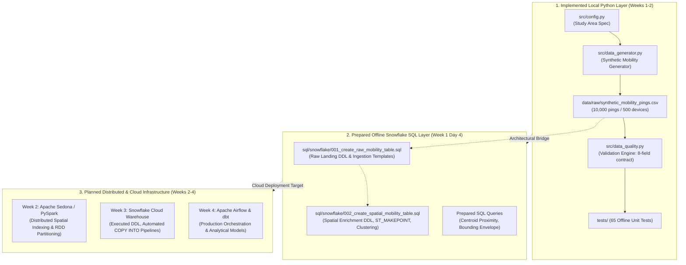

# GeoPulse — Week 1 Day 4: Spatial Data Engineering Preparation Report

**Project**: GeoPulse — Hyper-Local Retail Mobility Analytics
**Phase**: Week 1 Day 4
**Date**: November 2026
**Status**: Implemented & Verified (Offline / Local-First Development)
**Target Platform**: Snowflake Data Cloud (Prepared DDL & Transformation Specifications)
**Coordinate Reference System**: WGS 84 (EPSG:4326)
**Canonical Dataset**: `data/raw/synthetic_mobility_pings.csv` (10,000 pings, 500 devices, 8 columns)
**Dataset SHA-256**: `a5070e6a0d94ba6ddc23151564c42d1365d0453cde83c55513f4cda14a124aa8`

---

## 1. Executive Summary & Objective

The primary objective of Week 1 Day 4 is to establish the production-grade data engineering bridge connecting GeoPulse's local, synthetic mobility generation layer with modern cloud data warehousing standards. Specifically, this milestone delivers declarative Snowflake Data Cloud DDL and spatial transformation scripts that prepare the existing synthetic GPS telemetry dataset for enterprise-scale spatial analytics while strictly maintaining a local-first, offline development posture.

All SQL artifacts developed in this milestone were designed, validated, and documented without connecting to active cloud services, provisioning external infrastructure, or introducing proprietary runtime dependencies. The resulting schemas strictly adhere to the project's canonical 8-field data dictionary contract, implement geodetic spatial geometry best practices (WGS 84 / EPSG:4326), and establish micro-partition clustering strategies optimized for spatio-temporal retail corridor analytics.

---

## 2. Deliverable Inventory & Scope

The following deliverables have been constructed and integrated into the GeoPulse repository:

| Deliverable File | Target Schema / Location | Purpose & Architectural Scope |
| :--- | :--- | :--- |
| `sql/snowflake/001_create_raw_mobility_table.sql` | `GEOPULSE_DB.RAW.RAW_MOBILITY_PINGS` | Raw landing table DDL mirroring the canonical 8-field CSV schema with exact Snowflake types, audit columns, file format, stage, and `COPY INTO` templates. |
| `sql/snowflake/002_create_spatial_mobility_table.sql` | `GEOPULSE_DB.STAGING.STG_SPATIAL_MOBILITY_PINGS` | Spatially enriched table DDL featuring native Snowflake `GEOGRAPHY`, spatial point construction (`ST_MAKEPOINT`), micro-partition clustering, transformation DML, and spatial query templates. |
| `reports/WEEK1_DAY4_SPATIAL_ENGINEERING_REPORT.md` | `reports/` | Comprehensive architectural report documenting table designs, geodetic CRS decisions, constraint semantics, layer boundaries, and verification audits. |
| `docs/DATA_DICTIONARY.md` | `docs/` | Updated coordinate specification sections to explicitly state inclusive bounding-box containment. |
| `docs/TECHNICAL_OVERVIEW.md` | `docs/` | Updated Day 3 milestone to Implemented, added Day 4 Prepared milestone, and expanded Section 2.3 with spatial table architecture notes. |
| `README.md` | Root | Updated project status badge to Week 1 Day 4 Complete, refreshed repository tree with `sql/snowflake/`, and updated milestone checklist. |

---

## 3. Raw Landing Table Design (`RAW_MOBILITY_PINGS`)

The raw landing table (`GEOPULSE_DB.RAW.RAW_MOBILITY_PINGS`) is designed to receive unprocessed telemetry records directly from staged CSV files with zero transformation overhead.

### 3.1 Field-to-Column Mapping Contract

Every column in `RAW_MOBILITY_PINGS` corresponds directly to one of the 8 canonical fields defined in `docs/DATA_DICTIONARY.md`:

```sql
CREATE OR REPLACE TABLE GEOPULSE_DB.RAW.RAW_MOBILITY_PINGS (
    ping_id                 VARCHAR(36)     NOT NULL,
    device_id               VARCHAR(36)     NOT NULL,
    event_timestamp         TIMESTAMP_TZ    NOT NULL,
    latitude                NUMBER(9, 6)    NOT NULL,
    longitude               NUMBER(9, 6)    NOT NULL,
    accuracy_meters         NUMBER(4, 1)    NOT NULL,
    movement_mode           VARCHAR(30)     NOT NULL,
    data_provenance         VARCHAR(50)     NOT NULL,
    _ingested_at            TIMESTAMP_NTZ   NOT NULL DEFAULT CURRENT_TIMESTAMP(),
    _staged_file_name       VARCHAR(255),
    _staged_file_row_number NUMBER(10, 0),
    CONSTRAINT pk_raw_mobility_pings PRIMARY KEY (ping_id)
);
```

### 3.2 Type Selection Rationale

1. **Identifiers (`ping_id`, `device_id`)**: Mapped to `VARCHAR(36)` to accommodate standard RFC 4122 canonical string representations of UUIDv4 (32 hex characters plus 4 hyphens).
2. **Temporal Observation (`event_timestamp`)**: Mapped to `TIMESTAMP_TZ` (timezone-aware timestamp). Ingestion handles ISO-8601 UTC strings (`YYYY-MM-DDTHH:MM:SS[.fff]Z`), ensuring unambiguous preservation of UTC temporal offsets without silent conversion to local session timezones.
3. **Geodetic Coordinates (`latitude`, `longitude`)**: Stored as exact scalar fixed-point numbers `NUMBER(9, 6)`. With 6 fractional decimal digits, precision is maintained at approximately $0.111\text{ m}$ (11.1 cm) at the equator. This prevents floating-point rounding errors (`FLOAT`/`DOUBLE`) during raw ingestion.
4. **Positional Uncertainty (`accuracy_meters`)**: Stored as `NUMBER(4, 1)` representing horizontal accuracy radii in meters ($[2.0, 35.0]\text{ m}$).
5. **Kinematic Mode & Provenance (`movement_mode`, `data_provenance`)**: Mapped to `VARCHAR(30)` and `VARCHAR(50)` respectively, capturing discrete string classifications (`pedestrian_walking`, `stationary_dwell`, `vehicular_transit`) and constant origin tags (`geopulse_synthetic_v1`).
6. **Ingestion Audit Columns (`_ingested_at`, `_staged_file_name`, `_staged_file_row_number`)**: Standard data engineering lineage attributes capturing warehouse ingestion timestamps and file lineage without altering the 8 business columns.

---

## 4. Spatially Enriched Table Design (`STG_SPATIAL_MOBILITY_PINGS`)

The staging spatial table (`GEOPULSE_DB.STAGING.STG_SPATIAL_MOBILITY_PINGS`) augments the raw tabular schema with a native Snowflake `GEOGRAPHY` point object and micro-partition clustering.

### 4.1 Schema Definition & Clustering

```sql
CREATE OR REPLACE TABLE GEOPULSE_DB.STAGING.STG_SPATIAL_MOBILITY_PINGS (
    ping_id             VARCHAR(36)     NOT NULL,
    device_id           VARCHAR(36)     NOT NULL,
    event_timestamp     TIMESTAMP_TZ    NOT NULL,
    latitude            NUMBER(9, 6)    NOT NULL,
    longitude           NUMBER(9, 6)    NOT NULL,
    coordinates_geo     GEOGRAPHY       NOT NULL,
    accuracy_meters     NUMBER(4, 1)    NOT NULL,
    movement_mode       VARCHAR(30)     NOT NULL,
    data_provenance     VARCHAR(50)     NOT NULL,
    _transformed_at     TIMESTAMP_NTZ   NOT NULL DEFAULT CURRENT_TIMESTAMP(),
    CONSTRAINT pk_spatial_mobility_pings PRIMARY KEY (ping_id)
)
CLUSTER BY (DATE(event_timestamp), movement_mode);
```

### 4.2 Micro-Partition Clustering Rationale

Snowflake partitions data automatically into immutable micro-partitions (50 MB to 500 MB uncompressed). For retail mobility analytics, analytical queries overwhelmingly filter along two primary dimensions:
1. **Temporal Horizon**: Filtering or aggregating by observation date (`DATE(event_timestamp)`), such as isolating weekday vs. weekend footfall.
2. **Behavioral Cohort**: Segmenting by kinematic state (`movement_mode`), such as isolating slow-moving pedestrians entering retail storefront catchments from fast-moving vehicular transit along arterial roads.

Declaring `CLUSTER BY (DATE(event_timestamp), movement_mode)` aligns physical micro-partition storage with these access patterns, maximizing query pruning and minimizing scanned byte volume during spatial corridor joins.

---

## 5. Spatial Architecture, CRS, and Coordinate Representation Decisions

### 5.1 Coordinate Reference System: WGS 84 (EPSG:4326)

All spatial telemetry in GeoPulse is referenced to the **World Geodetic System 1984 (WGS 84)**, identified by authority code **EPSG:4326**. WGS 84 is the global standard for GPS satellite navigation, mobile device positioning engines, GeoJSON representations, and OpenGIS specifications.

### 5.2 Snowflake `GEOGRAPHY` vs. `GEOMETRY`

Snowflake provides two distinct geospatial data types:
- **`GEOMETRY`**: Represents features on a flat, Euclidean Cartesian plane ($X, Y$). Calculations assume a flat projection and do not account for the curvature of the Earth unless explicitly reprojected to local projected coordinate systems (e.g., UTM Zone 43N).
- **`GEOGRAPHY`**: Represents features on the WGS 84 geodetic ellipsoid ($lon, lat$). Calculations use spherical and ellipsoidal geodesics, computing true surface distances and geodesic polygon containment natively in meters.

**Architectural Decision**: GeoPulse selects **`GEOGRAPHY`** because GPS telemetry observations represent true ellipsoidal coordinates on the Earth's surface. Functions such as `ST_DISTANCE(point1, point2)` natively return geodesic distances in meters without requiring map projection transformations, avoiding planar distortion across Bangalore's equatorial latitude (~12.97° N).

### 5.3 Spatial Point Construction Order Convention

A critical point of failure in spatial data engineering is coordinate order inversion (the "$X/Y$ vs. $Lat/Lon$" problem):
- Everyday colloquial speech places **Latitude first, Longitude second** ("12.97° N, 77.64° E").
- Formal GIS standards (OpenGIS Simple Features, OGC WKT, GeoJSON, and Snowflake SQL) place **$X$ (Longitude) first, $Y$ (Latitude) second** ("77.64° E, 12.97° N").

In Snowflake, `ST_MAKEPOINT` strictly requires:
$$\text{ST\_MAKEPOINT}(\text{longitude}, \text{latitude})$$

Passing latitude first would swap the axis, placing coordinates near the Somali Sea off the coast of East Africa. GeoPulse's DDL and transformation scripts enforce:
```sql
ST_MAKEPOINT(raw.longitude, raw.latitude) AS coordinates_geo
```

### 5.4 Tabular Coordinates vs. Spatially Enriched `GEOGRAPHY`

GeoPulse intentionally retains both scalar coordinate columns (`latitude`, `longitude` as `NUMBER(9,6)`) and the binary `coordinates_geo GEOGRAPHY` column in the staging table:

| Dimension | Raw Scalar Coordinates (`NUMBER(9,6)`) | Spatially Enriched (`GEOGRAPHY`) |
| :--- | :--- | :--- |
| **Storage Structure** | Fixed-point numeric scalars (2 separate columns) | Binary encoded spherical geometry object |
| **Precision Guarantee** | Exact 6-decimal fixed-point contract ($0.111\text{ m}$) | Internal double-precision floating geodetic point |
| **Relational Filtering** | Simple B-tree / range scans (`BETWEEN min AND max`) | Spatial predicate pruning via geospatial bounding boxes |
| **Spatial Intelligence** | None (requires external mathematical formulas) | Native support for `ST_DISTANCE`, `ST_CONTAINS`, `ST_DWITHIN` |
| **Catchment Analysis** | Impossible without trigonometric UDFs | Natively evaluates polygon containment and corridor buffers |
| **Interoperability** | Standard tabular tools (Pandas, Excel, CSV) | GIS tools (QGIS, Kepler.gl, Sedona, PostGIS, Mapbox) |

---

## 6. Snowflake Constraint Architecture & Upstream Certification

### 6.1 Informational vs. Enforced Constraints

A crucial architectural consideration when designing Snowflake schemas is the platform's constraint enforcement model:

1. **`NOT NULL` Constraints**: Strictly enforced by the Snowflake storage engine at ingestion and insertion time. Any row containing a null value in a `NOT NULL` column will cause load failure.
2. **`PRIMARY KEY` and `UNIQUE` Constraints**: In Snowflake, primary key and uniqueness constraints are **informational only** (`RELY` or `NORELY`). They are stored as table metadata to assist the cost-based query optimizer (enabling join elimination and cardinality estimation), but are **not enforced** by the database engine during `COPY INTO`, `INSERT`, or `MERGE` operations. Duplicate keys will not cause runtime load errors.

### 6.2 GeoPulse Upstream Certification Strategy

Because Snowflake does not natively prevent primary key collisions, GeoPulse enforces uniqueness guarantees upstream in the Python data-quality layer:
- The synthetic generator (`src/data_generator.py`) generates unique RFC 4122 UUIDv4 identifiers for each ping.
- The validation engine (`src/data_quality.py`) rigorously validates that 100% of `ping_id` values are unique before any data is staged or loaded into the data warehouse.
- Upstream verification guarantees that raw data delivered to Snowflake satisfies relational uniqueness without relying on database engine enforcement.

---

## 7. Architectural Lifecycle & Scope Classification

To ensure operational clarity across development phases, GeoPulse maintains strict boundaries between currently implemented, prepared, and planned components:



1. **Implemented (Active Local Python Engine)**:
   - Synthetic generator, configuration constants, data quality validation engine, and 65 unit tests running offline.
2. **Prepared (Offline SQL Specifications)**:
   - Declarative DDL scripts (`001_create_raw_mobility_table.sql` and `002_create_spatial_mobility_table.sql`) providing production schemas, spatial constructors, clustering keys, and query templates. These remain offline and unexecuted during Week 1.
3. **Planned (Future Weeks 2–4)**:
   - Week 2: Apache Sedona on PySpark for distributed spatial trajectory partitioning.
   - Week 3: Snowflake cloud provisioning, live ingestion pipeline execution, and dbt transformation models.
   - Week 4: Apache Airflow workflow orchestration and interactive BI dashboarding.

---

## 8. Local Verification and Integrity Audit

### 8.1 Test Suite Execution

All 65 automated tests across the test suite were executed locally and passed with zero failures:

```
PS C:\project\geopulse-hyperlocal-retail-mobility-analytics> python -m unittest discover -s tests -v
test_all_features_have_properties (test_study_area_spec.TestStudyAreaSpec.test_all_features_have_properties) ... ok
test_bounding_box_coordinates (test_study_area_spec.TestStudyAreaSpec.test_bounding_box_coordinates) ... ok
...
test_full_suite_passes_canonical_dataset (test_data_quality.TestDataQualitySuite.test_full_suite_passes_canonical_dataset) ... ok
test_generate_synthetic_pings_deterministic (test_data_generator.TestDataGenerator.test_generate_synthetic_pings_deterministic) ... ok
...
----------------------------------------------------------------------
Ran 65 tests in 0.528s

OK
```

### 8.2 Dataset Integrity & Preservation Audit

The canonical dataset `data/raw/synthetic_mobility_pings.csv` was verified to remain untouched throughout Day 4 activities:
- **Expected SHA-256**: `a5070e6a0d94ba6ddc23151564c42d1365d0453cde83c55513f4cda14a124aa8`
- **Observed SHA-256**: `a5070e6a0d94ba6ddc23151564c42d1365d0453cde83c55513f4cda14a124aa8`
- **Status**: Perfectly Preserved (Zero Modifications)

### 8.3 Git Repository Cleanliness

- `git diff --check`: Clean (zero trailing whitespace, zero merge conflict artifacts).
- Preservation constraints verified: Day 1 and Day 2 generator and spec code untouched; all Day 4 deliverables cleanly isolated in `sql/snowflake/` and `reports/`.

---

## 9. Conclusion & Next Steps

Week 1 Day 4 successfully bridges GeoPulse's local Python data generation and quality assurance layers with production cloud data engineering standards. By establishing declarative, offline-validated Snowflake schemas with native WGS 84 `GEOGRAPHY` support, the project is cleanly positioned for Week 2's distributed spatial processing pipeline using Apache Sedona and PySpark.
